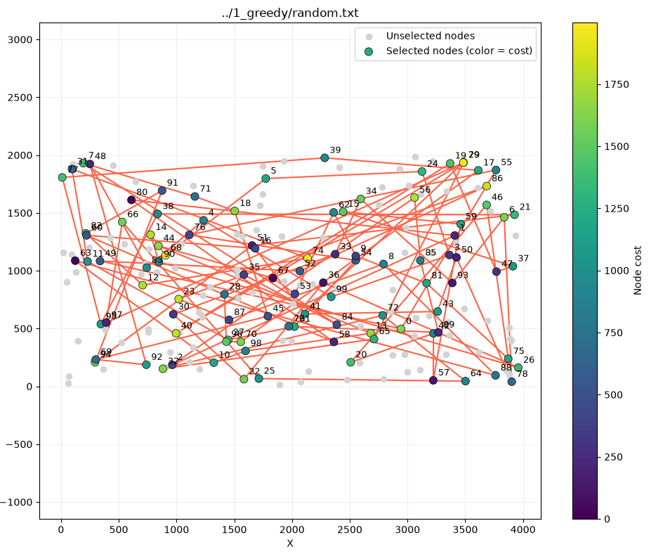
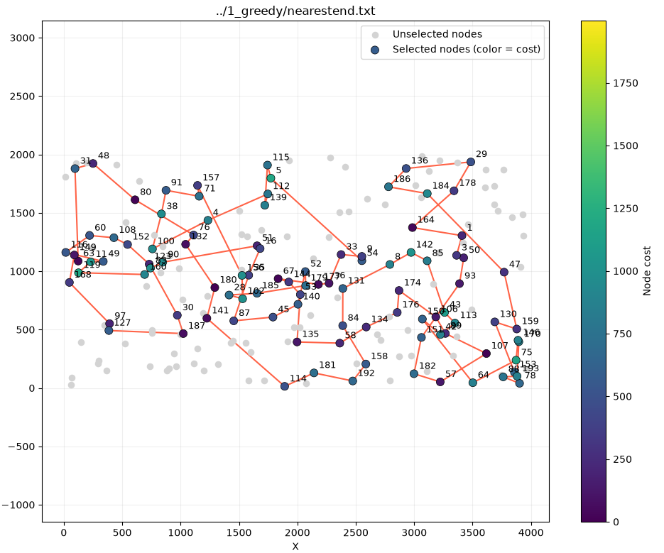
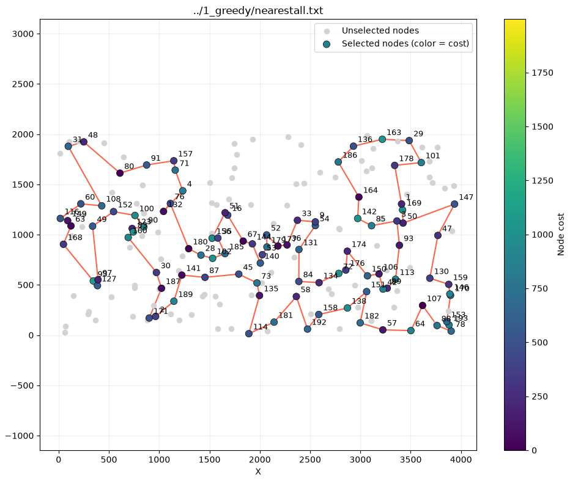
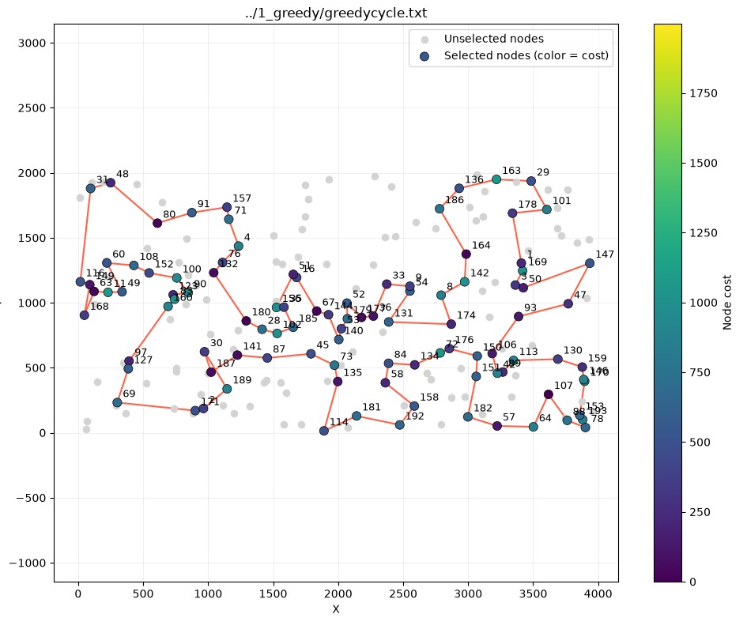

# Greedy heuristics

### Hubert Nowakowski 160302

### Mukhammad Sattorov 159351

### Code link: https://github.com/hnowakowski?tab=repositories

## Description of the problem

We're trying to find a hamiltonian cycle where:

- function to be minimized is defined as distance + cost
- we want to have the cycle consist of exactly 50% of nodes
- distances between nodes are rounded euclidean

All solutions are described as a vector of subsequent node indices, their objectives were tested using the solution checker excel on TSPA.csv

## Approaches and pseudocode

### Random

We pick subsequent nodes at random until we reach a desired length of the cycle.

Time complexity: O(n)

```
put first node into solution
create vector with a pool of available nodes (all aside from the initial node)
while solution size < desired length:
    pick node at random and add it to solution
    remove node from pool
return solution
```

Max objective: 273658
Average objective: 255106
Min objective: 234696
Best solution out of 200 runs:

```
17 39 77 95 38 21 51 94 91 82 12 74 31 11 27 61 54 76 55 0 49 52 86 23 87 8 88 63 10 98 13 44 67 53 62 9 81 75 46 20 42 57 59 15 37 47 19 40 29 65 32 72 64 25 66 97 79 73 89 85 56 2 1 80 58 60 16 41 43 50 78 6 93 34 33 30 22 36 26 90 14 68 5 24 3 99 4 83 48 92 69 45 18 71 7 84 35 28 96 70
```



### Nearest neighbour end only

On each iteration, we pick the nearest (lowest objective function increase) node from the current end node. At the end we create a direct connection from the end node to the start.

Time complexity: O(n^2)

```
put first node into solution
create vector with a pool of available nodes (all aside from the initial node)
set starting node as the current node
while solution size < desired length:
    for each node that exists:
        if it's the current node or isn't in the pool of available nodes, continue
        else, if this node is the nearest to the current one, keep track of it
    add nearest node to the solution and remove it from the pool
    set nearest node as the new current node
return solution
```

Max objective: 90075
Average objective: 87476
Min objective: 84362
Best solution out of 200 runs:

```
54 9 33 36 177 67 144 53 135 58 134 176 174 106 89 107 57 182 151 93 50 3 1 164 178 29 136 186 184 47 159 130 153 78 88 193 170 146 75 64 150 42 113 43 85 142 8 131 84 158 192 181 114 141 180 132 76 80 48 31 63 149 168 97 127 187 30 123 152 108 60 116 49 11 119 160 83 90 51 16 35 87 45 140 52 179 185 28 102 156 157 71 91 38 100 4 112 139 115 5
```



### Nearest neighbour all possibilities

On each iteration, we pick the nearest (lowest objective function increase) node from all possible node insertion points. At the end we create a direct connection from the end node to the start.

Time complexity: O(n^3)

```
put first node into solution
create vector with a pool of available nodes (all aside from the initial node)
while solution size < desired length:
    for each j from 0 to solution length + 1:
        for each k node that exists:
            if the node k is not in the pool, continue
            else if j == 0 and matrix[k][solution[j]] < smallest objective so far, set as current choice
            else if j == solution length and matrix[solution[j-1]][k] < smallest objective so far, set as current choice
            else if -matrix[solution[j-1]][solution[j]] + matrix[solution[j-1]][k] + matrix[k][solution[j]] < smallest objective so far, set as current choice
    insert best node at best position
    add node to the pool
return solution
```

Max objective: 76623
Average objective: 74707
Min objective: 73176
Best solution out of 200 runs:

```
64 107 88 78 193 153 170 146 159 130 47 147 50 169 1 178 101 29 163 136 186 164 142 85 3 93 113 89 42 106 150 174 176 72 134 84 131 54 9 33 36 177 52 179 53 140 144 67 16 51 156 35 185 102 28 180 76 132 4 71 157 91 80 48 31 108 60 116 149 63 168 95 127 97 49 152 100 90 123 83 160 30 187 171 2 189 141 87 45 73 135 114 181 58 192 158 138 151 182 57
```



### Greedy cycle

On each iteration, expand our current cycle by adding the nearest node from any possible node insertion points. Very similar to previous approach, except we constantly treat the vector as a cycle so at the end we don't need to add a connection to the beginning.

Time complexity: O(n^3)

```
put first node into solution
create vector with a pool of available nodes (all aside from the initial node)
while solution size < desired length:
    for each j from 0 to solution length + 1:
        for each k node that exists:
            if the node k is not in the pool, continue
            if j == 0 and -matrix[solution[solution size - 1]][solution[j]] + matrix[solution[solution size - 1]][k] + matrix[k][solution[j]] < smallest objective so far, set as current choice
            else if -matrix[solution[j-1]][solution[j]] + matrix[solution[j-1]][k] + matrix[k][solution[j]] < smallest objective so far, set as current choice
    insert best node at best position
    add node to the pool
return solution
```

Max objective: 75281
Average objective: 73743
Min objective: 72590
Best solution out of 200 runs:

```
116 149 168 63 11 49 60 108 152 100 90 123 83 160 97 127 69 171 2 189 30 187 141 87 45 73 135 114 181 192 158 58 84 134 72 176 150 151 182 57 64 107 88 78 193 153 170 146 159 130 113 89 42 106 93 47 147 50 3 169 1 178 101 29 163 136 186 164 142 8 174 131 54 9 33 36 177 52 179 53 140 144 67 16 51 156 35 185 102 28 180 132 76 4 71 157 91 80 48 31
```



## Conclusions

While the random approach is well...random, greedy approaches present a tradeoff dynamic. If we consider only the nearest neighbour of the last node, we have to do much less computation, but will miss out on more optimal solutions that the all possibilities variant explores. While the processing time is MUCH longer, it does yield substantially better scores on our test dataset. And, as a further refinement, we can also take care of the issue with a horrendously unoptimal final edge by treating the solution as a loop throughout the algorithm with the greedy cycle method.
