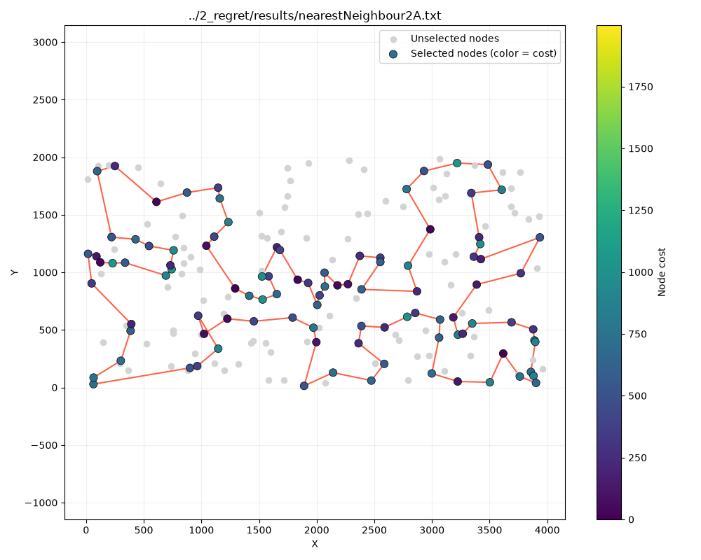
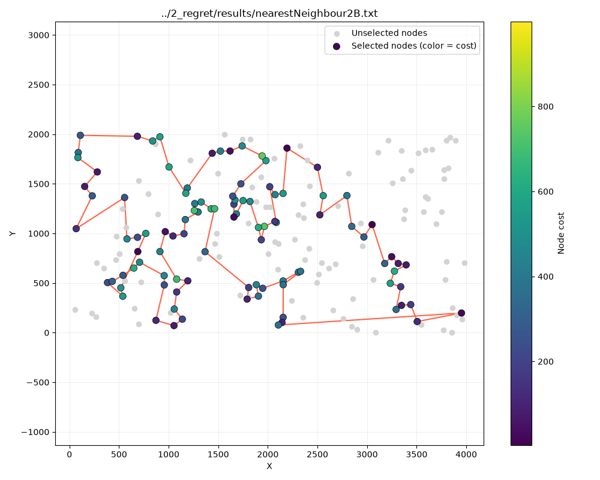
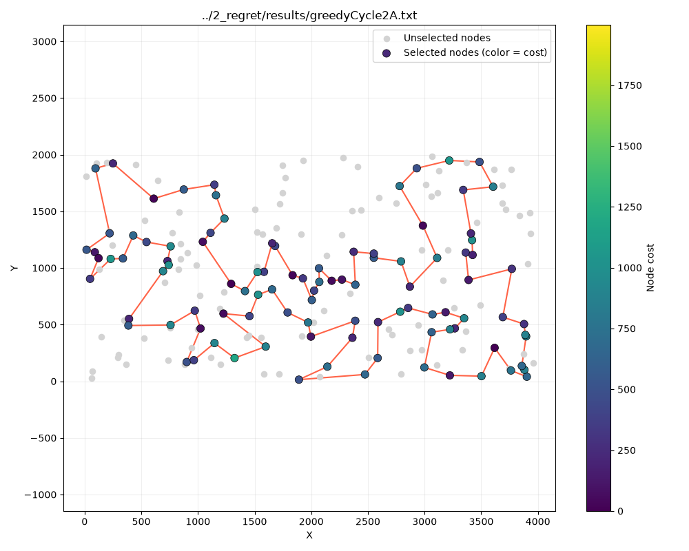
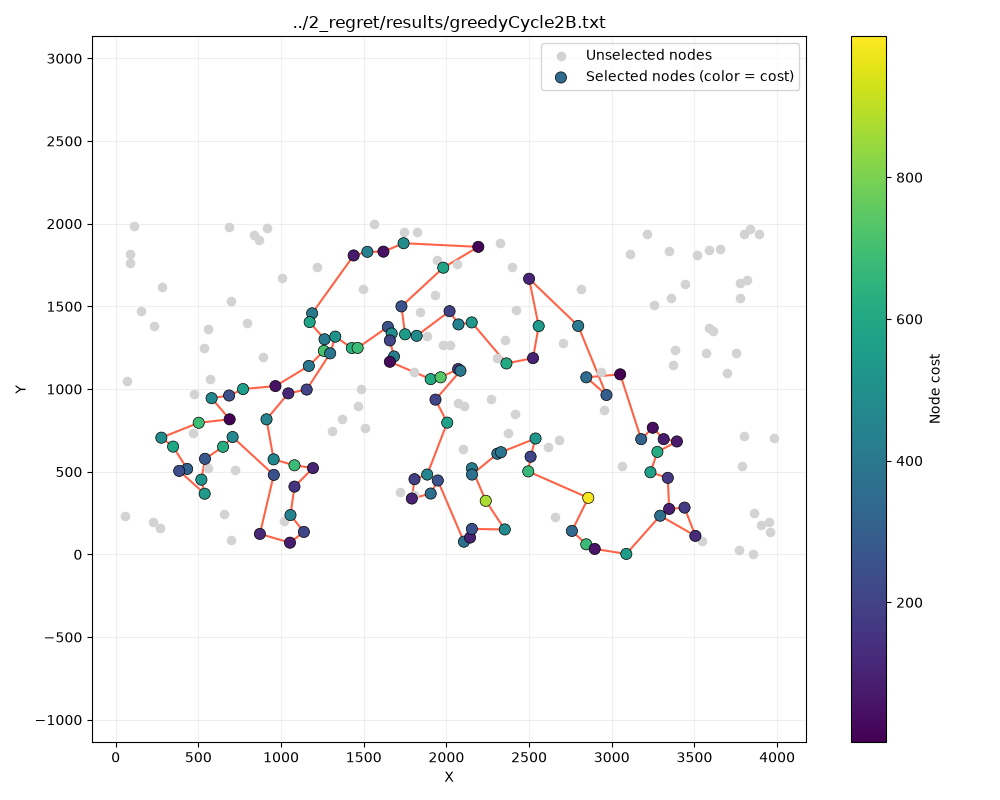
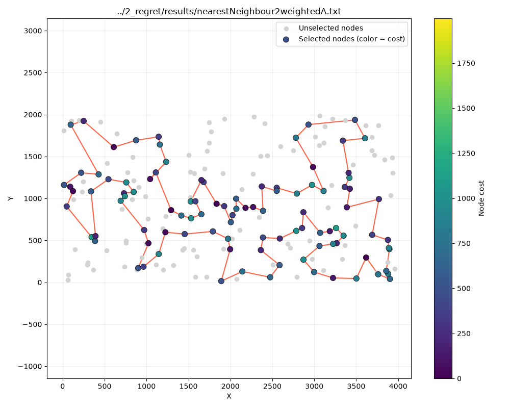
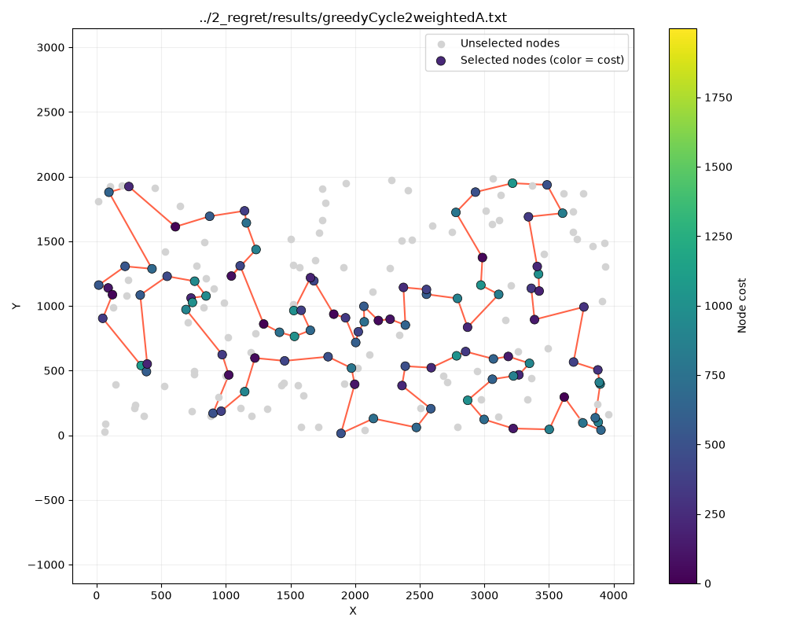
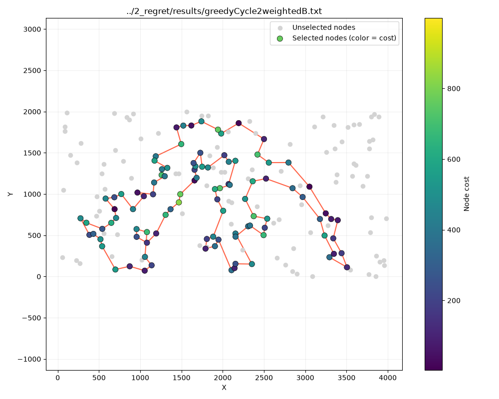

# Greedy regret heuristics

### Hubert Nowakowski 160302

### Mukhammad Sattorov 159351

### Code link: https://github.com/hnowakowski/Evolutionary-Computation-2026/blob/main/2_regret/main.cpp

## Description of the problem

We're trying to find a hamiltonian cycle where:

- function to be minimized is defined as distance + cost
- we want to have the cycle consist of exactly 50% of nodes
- distances between nodes are rounded euclidean

All solutions are described as a vector of subsequent node indices, their objectives were tested using the solution checker excel sheet

## Approaches and pseudocode

### Nearest neighbour 2-regret

On each iteration, we pick the nearest node from all the possible insertion points. Then, we find the second best node for that spot, and pick one where each node's difference between its best and second best insertion option is larger. At the end we create a direct connection from the end node to the start.

Time complexity: O(n^3)

```
add first node into solution
create vector contains
add first node to used nodes list
create vector of vectors insertionCosts
while solution size < desired length:
    clear insertionCosts
    for j from 0 to solution length + 1:
        for k from 0 to matrix length:
            if contains[k] == true, continue
            else if j == 0:
                if matrix[k][solution[j]] + nodes[k].cost < smallest objective so far:
                    set as current choice
                insertionCosts[k][j] = matrix[k][solution[j]] + nodes[k].cost
            else if j == solution length:
                if matrix[solution[j-1]][k] + nodes[k].cost < smallest objective so far:
                    set as current choice
                insertionCosts[k][j] = matrix[solution[j-1]][k] + nodes[k].cost
            else
                if -matrix[res[j-1]][res[j]] + matrix[res[j - 1]][k] + matrix[k][res[j]] + nodes[k].cost < smallest objective so far:
                    set as current choice
                insertionCosts[k][j] = -matrix[res[j-1]][res[j]] + matrix[res[j - 1]][k] + matrix[k][res[j]] + nodes[k].cost

    if solution.length == 1:
        insert best node at best position
        contains[best node idx] = true
        continue

    no1BestCurr = best node
    no2BestCurr = 2nd best slot best node can be inserted in
    no1BestRunnerUp = 2nd best node candidate for the best slot
    no2BestRunnerUp = 2nd best slot the 2nd best node candidate can be inserted in

    if (no2BestCurr.cost - no1BestCurr.cost) < (no2BestRunnerUp.cost - no1BestRunnerUp.cost):
        add 2nd best node into solution
        contains[2nd best node idx] = true
    else:
        add best node into solution
        contains[best node idx] = true

return solution
```

TSPA:<br>
Max objective: 77022<br>
Average objective: 74306<br>
Min objective: 72328<br>

TSPB:<br>
Max objective: 66164<br>
Average objective: 59476<br>
Min objective: 52915<br>




### Greedy cycle 2-regret

On each iteration, we pick the nearest node from all the possible insertion points, while treating insertion costs as if the solution was already a closed cycle. Then, we find the second best node for that spot, and pick one where each node's difference between its best and second best insertion option is larger.

Time complexity: O(n^3)

```
add first node into solution
create vector contains
add first node to used nodes list
create vector of vectors insertionCosts
while solution size < desired length:
    clear insertionCosts
    for j from 0 to solution length + 1:
        for k from 0 to matrix length:
            if contains[k] == true, continue
            else if j == 0:
                if -matrix[res[res.size() - 1]][res[j]] + matrix[res[res.size() - 1]][k] + matrix[k][res[j]] + nodes[k].cost < smallest objective so far:
                    set as current choice
                insertionCosts[k][j] = -matrix[res[res.size() - 1]][res[j]] + matrix[res[res.size() - 1]][k] + matrix[k][res[j]] + nodes[k].cost
            else if j == solution length:
                if -matrix[res[res.size() - 1]][res[0]] + matrix[res[res.size() - 1]][k] + matrix[k][res[0]] + nodes[k].cost < smallest objective so far:
                    set as current choice
                insertionCosts[k][j] = -matrix[res[res.size() - 1]][res[0]] + matrix[res[res.size() - 1]][k] + matrix[k][res[0]] + nodes[k].cost
            else
                if -matrix[res[j - 1]][res[j]] + matrix[res[j - 1]][k] + matrix[k][res[j]] + nodes[k].cost < smallest objective so far:
                    set as current choice
                insertionCosts[k][j] = -matrix[res[j - 1]][res[j]] + matrix[res[j - 1]][k] + matrix[k][res[j]] + nodes[k].cost

    if solution.length == 1:
        insert best node at best position
        contains[best node idx] = true
        continue

    no1BestCurr = best node
    no2BestCurr = 2nd best slot best node can be inserted in
    no1BestRunnerUp = 2nd best node candidate for the best slot
    no2BestRunnerUp = 2nd best slot the 2nd best node candidate can be inserted in

    if (no2BestCurr.cost - no1BestCurr.cost) < (no2BestRunnerUp.cost - no1BestRunnerUp.cost):
        add 2nd best node into solution
        contains[2nd best node idx] = true
    else:
        add best node into solution
        contains[best node idx] = true

return solution
```

TSPA:<br>
Max objective: 75585<br>
Average objective: 73817<br>
Min objective: 72886<br>

TSPB:<br>
Max objective: 63641<br>
Average objective: 59371<br>
Min objective: 53245<br>




### Nearest neighbour 2-regret weighted

On each iteration, we pick the nearest node from all the possible insertion points. Then, we find the second best node for that spot, pick the one for which 0.5 \* regret + 0.5 cost. At the end we create a direct connection from the end node to the start.

Time complexity: O(n^3)

```
alpha = 0.5
add first node into solution
create vector contains
add first node to used nodes list
create vector of vectors insertionCosts
while solution size < desired length:
    clear insertionCosts
    for j from 0 to solution length + 1:
        for k from 0 to matrix length:
            if contains[k] == true, continue
            else if j == 0:
                if matrix[k][solution[j]] + nodes[k].cost < smallest objective so far:
                    set as current choice
                insertionCosts[k][j] = matrix[k][solution[j]] + nodes[k].cost
            else if j == solution length:
                if matrix[solution[j-1]][k] + nodes[k].cost < smallest objective so far:
                    set as current choice
                insertionCosts[k][j] = matrix[solution[j-1]][k] + nodes[k].cost
            else
                if -matrix[res[j-1]][res[j]] + matrix[res[j - 1]][k] + matrix[k][res[j]] + nodes[k].cost < smallest objective so far:
                    set as current choice
                insertionCosts[k][j] = -matrix[res[j-1]][res[j]] + matrix[res[j - 1]][k] + matrix[k][res[j]] + nodes[k].cost

    if solution.length == 1:
        insert best node at best position
        contains[best node idx] = true
        continue

    no1BestCurr = best node
    no2BestCurr = 2nd best slot best node can be inserted in
    no1BestRunnerUp = 2nd best node candidate for the best slot
    no2BestRunnerUp = 2nd best slot the 2nd best node candidate can be inserted in

    if ((no2BestCurrCost - no1BestCurrCost) * (1.0 - alpha)) + -(no1BestCurrCost * alpha) < ((no2BestRunnerUpCost - no1BestRunnerUpCost) * (1.0 - alpha)) + -(no1BestRunnerUpCost * alpha):
        add 2nd best node into solution
        contains[2nd best node idx] = true
    else:
        add best node into solution
        contains[best node idx] = true

return solution
```

TSPA:<br>
Max objective: 77755<br>
Average objective: 74513<br>
Min objective: 72505<br>

TSPB:<br>
Max objective: 61579<br>
Average objective: 57535<br>
Min objective: 52646<br>




### Greedy cycle 2-regret weighted

On each iteration, we pick the nearest node from all the possible insertion points, while treating insertion costs as if the solution was already a closed cycle. Then, we find the second best node for that spot, pick the one for which 0.5 \* regret + 0.5 cost.

Time complexity: O(n^3)

```
alpha = 0.5
add first node into solution
create vector contains
add first node to used nodes list
create vector of vectors insertionCosts
while solution size < desired length:
    clear insertionCosts
    for j from 0 to solution length + 1:
        for k from 0 to matrix length:
            if contains[k] == true, continue
            else if j == 0:
                if -matrix[res[res.size() - 1]][res[j]] + matrix[res[res.size() - 1]][k] + matrix[k][res[j]] + nodes[k].cost < smallest objective so far:
                    set as current choice
                insertionCosts[k][j] = -matrix[res[res.size() - 1]][res[j]] + matrix[res[res.size() - 1]][k] + matrix[k][res[j]] + nodes[k].cost
            else if j == solution length:
                if -matrix[res[res.size() - 1]][res[0]] + matrix[res[res.size() - 1]][k] + matrix[k][res[0]] + nodes[k].cost < smallest objective so far:
                    set as current choice
                insertionCosts[k][j] = -matrix[res[res.size() - 1]][res[0]] + matrix[res[res.size() - 1]][k] + matrix[k][res[0]] + nodes[k].cost
            else
                if -matrix[res[j - 1]][res[j]] + matrix[res[j - 1]][k] + matrix[k][res[j]] + nodes[k].cost < smallest objective so far:
                    set as current choice
                insertionCosts[k][j] = -matrix[res[j - 1]][res[j]] + matrix[res[j - 1]][k] + matrix[k][res[j]] + nodes[k].cost

    if solution.length == 1:
        insert best node at best position
        contains[best node idx] = true
        continue

    no1BestCurr = best node
    no2BestCurr = 2nd best slot best node can be inserted in
    no1BestRunnerUp = 2nd best node candidate for the best slot
    no2BestRunnerUp = 2nd best slot the 2nd best node candidate can be inserted in

   if ((no2BestCurrCost - no1BestCurrCost) * (1.0 - alpha)) + -(no1BestCurrCost * alpha) < ((no2BestRunnerUpCost - no1BestRunnerUpCost) * (1.0 - alpha)) + -(no1BestRunnerUpCost * alpha):
        add 2nd best node into solution
        contains[2nd best node idx] = true
    else:
        add best node into solution
        contains[best node idx] = true

return solution
```

TSPA:<br>
Max objective: 75132<br>
Average objective: 73396<br>
Min objective: 72430<br>

TSPB:<br>
Max objective: 63770<br>
Average objective: 58195<br>
Min objective: 52834<br>




## All scores so far

| Algorithm                           |  TSPA max | TSPA average |  TSPA min |  TSPB max | TSPB average |  TSPB min |
| ----------------------------------- | --------: | -----------: | --------: | --------: | -----------: | --------: |
| Random                              |    273658 |       255106 |    234696 |    221369 |       213252 |    196792 |
| Nearest neighbour end only          |     90075 |        87476 |     84362 |     63166 |        59397 |     56007 |
| Nearest neighbour all possibilities |     76623 |        74707 |     73176 |     67192 |        60635 |     56001 |
| Greedy cycle                        |     75281 |        73743 |     72590 |     63734 |        59650 |     55655 |
| Nearest neighbour 2-regret          |     77022 |        74306 | **72328** |     66164 |        59476 |     52915 |
| Greedy cycle 2-regret               |     75585 |        73817 |     72886 |     63641 |        59371 |     53245 |
| Nearest neighbour 2-regret weighted |     77755 |        74513 |     72505 | **61579** |    **57535** | **52646** |
| Greedy cycle 2-regret weighted      | **75132** |    **73396** |     72430 |     63770 |        58195 |     52834 |

## Conclusions

Taking regret into account improves scores all across the board, albeit not dramatically, especially for TSPA. For both datasets, the nearest neighbour approach achieves the best score, with the 2-regret and 2-regret weighted variants for TSPA and TSPB respectively.
