# Local search

### Hubert Nowakowski 160302

### Mukhammad Sattorov 159351

### Code link: https://github.com/hnowakowski/Evolutionary-Computation-2026/blob/main/3_local/main.cpp

## Description of the problem

We're trying to find a hamiltonian cycle where:

- function to be minimized is defined as distance + cost
- we want to have the cycle consist of exactly 50% of nodes
- distances between nodes are rounded euclidean

All solutions are described as a vector of subsequent node indices, their objectives were tested using the solution checker excel sheet

## Pseudocode

All combinations of approaches tested:

1. greedy local search using a random initial solution with swapping edges as the intra-solution move
2. greedy local search using a random initial solution with swapping nodes as the intra-solution move
3. greedy local search using a greedy heuristic initial solution with swapping edges as the intra-solution move
4. greedy local search using a greedy heuristic initial solution with swapping nodes as the intra-solution move
5. steepest local search using a random initial solution with swapping edges as the intra-solution move
6. steepest local search using a random initial solution with swapping nodes as the intra-solution move
7. steepest local search using a greedy heuristic initial solution with swapping edges as the intra-solution move
8. steepest local search using a greedy heuristic initial solution with swapping nodes as the intra-solution move

The greedy heuristic choice was based on the best average score on the previous lab, so:

- Greedy cycle 2-regret weighted for TSPA
- Nearest neighbour 2-regret weighted for TSPB

For greedy variants, the std::mt19937 random number generator was used

Let's go over all the initial components first, since they are reused often

### Calculating edge swap delta

given indices i, j, k, l
i -> j, k -> l turns into i -> k, j -> l

```
delta = 0
delta -= matrix[i][j]
delta -= matrix[k][l]
delta += matrix[i][k]
delta += matrix[j][l]
return delta
```

### Calculating intra node swap delta

given indices i, j

```
beforeI = (i == 0) ? sol.size() - 1 : i - 1
afterI = (i == sol.size() - 1) ? 0 : i + 1
beforeJ = (j == 0) ? sol.size() - 1 : j - 1
afterJ = (j == sol.size() - 1) ? 0 : j + 1
delta = 0
x = sol[i]
y = sol[j]

if (afterI == j) {
	delta -= matrix[sol[beforeI]][x]
	delta -= matrix[y][sol[afterJ]]
	delta += matrix[sol[beforeI]][y]
	delta += matrix[x][sol[afterJ]]
}
else if (i == 0 && j == sol.size() - 1) {
	delta -= matrix[sol[beforeJ]][y]
	delta -= matrix[x][sol[afterI]]
	delta += matrix[sol[beforeJ]][x]
	delta += matrix[y][sol[afterI]]
}
else {
    delta -= matrix[sol[beforeI]][x]
    delta -= matrix[x][sol[afterI]]
    delta -= matrix[sol[beforeJ]][y]
    delta -= matrix[y][sol[afterJ]]
    delta += matrix[sol[beforeI]][y]
    delta += matrix[y][sol[afterI]]
    delta += matrix[sol[beforeJ]][x]
    delta += matrix[x][sol[afterJ]]
}
return delta
```

### Calculating inter node swap delta

given indices i, j
where i is in the solution and j is outside

```
delta = 0
delta -= nodes[i].cost
delta += nodes[j].cost

beforeI = (i == 0) ? sol.size() - 1 : i - 1
afterI = (i == sol.size() - 1) ? 0 : i + 1
x = sol[i]
delta -= matrix[sol[beforeI]][x]
delta -= matrix[x][sol[afterI]]
delta += matrix[sol[beforeI]][j]
delta += matrix[j][sol[afterI]]
return delta
```

### Local search greedy edges

```
solution = initial_algorithm()
bool[200] contains
populate contains with all nodes in solution

vector<array[2]> nodeSwapPoolInter
populate with all possible node swaps

vector<array[4]> edgeSwapPool
populate with all possible edge swaps

while at least one pool is not empty{
    improved = false
    choice = randomly pick 0 or 1
    if (choice == 1 and nodeSwapPoolInter not empty){
        randomly pick index from 0 to nodeSwapPoolInter.size - 1
        fetch and pop selected swap from the pool
        calculate delta
        if (delta < 0){
            replace node in solution
            update contains
            improved = true
        }
    }
    else{
        if(edgeSwapPool not empty){
            randomly pick index from 0 to edgeSwapPool.size - 1
            fetch and pop selected swap from the pool
            calculate delta
            if (delta < 0){
                replace edge in solution
                improved = true
            }
        }
    }
    if (improved){
        clear and reset both pools
    }
}
return solution
```

#### Random initial solution - TSPA

Max objective: 79550<br>
Average objective: 76462<br>
Min objective: 73699<br>
Runtime: 1.19438 s

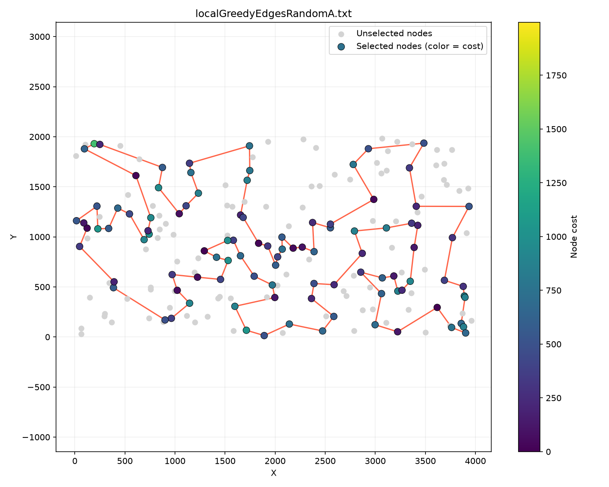

```
71 157 115 112 139 51 16 67 144 140 53 179 52 177 36 131 33 54 9 164 186 136 29 178 1 147 47 130 159 146 170 153 193 78 88 107 57 182 151 176 150 106 42 89 113 93 50 3 85 8 174 134 84 58 158 192 181 114 25 98 135 73 45 185 35 156 180 28 102 87 141 30 187 189 2 171 127 97 168 63 149 116 60 11 49 108 152 160 83 123 100 80 31 7 48 91 38 132 76 4
```

#### Random initial solution - TSPB

Max objective: 55870<br>
Average objective: 53075<br>
Min objective: 50767<br>
Runtime: 1.03015 s

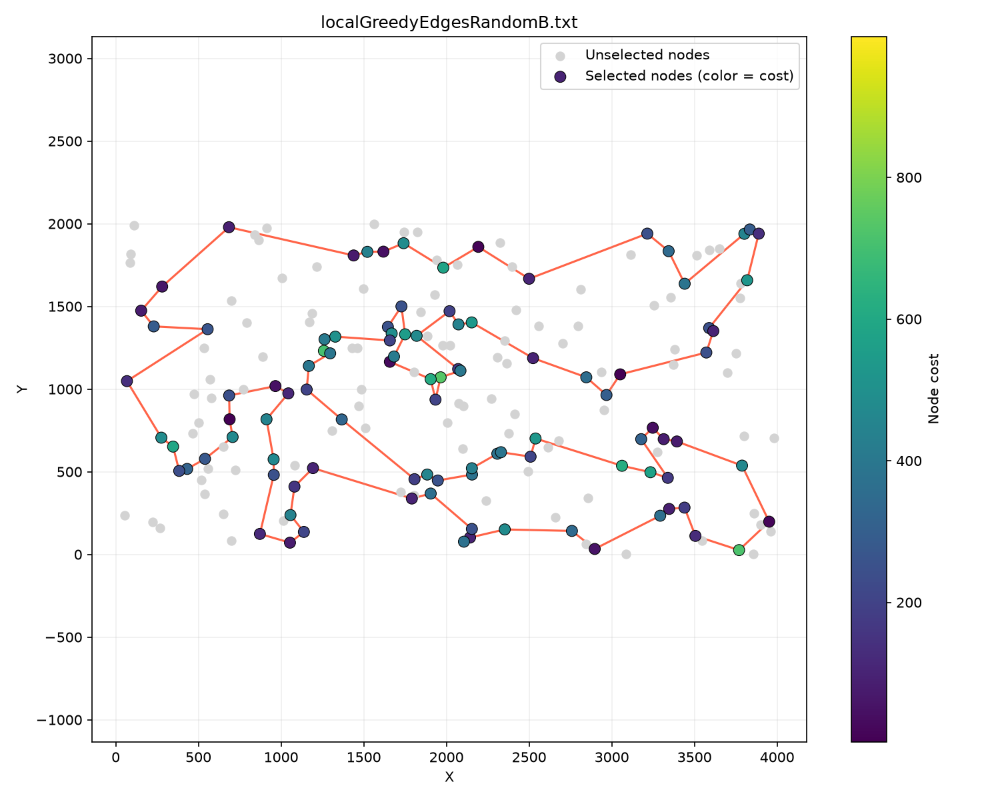

```
76 86 46 72 117 184 3 173 151 122 69 160 8 120 133 136 172 183 30 176 21 38 47 64 59 73 167 181 152 34 24 67 66 150 182 153 80 127 129 90 118 110 93 2 14 20 74 171 99 88 87 82 179 51 85 40 60 157 45 134 175 71 155 97 140 154 125 170 115 6 29 132 103 178 65 158 145 28 149 116 121 198 96 48 156 89 57 190 70 187 81 94 105 61 196 114 10 54 192 162
```

#### Heuristic initial solution - TSPA

Max objective: 74487<br>
Average objective: 72968<br>
Min objective: 72192<br>
Runtime: 0.176329 s

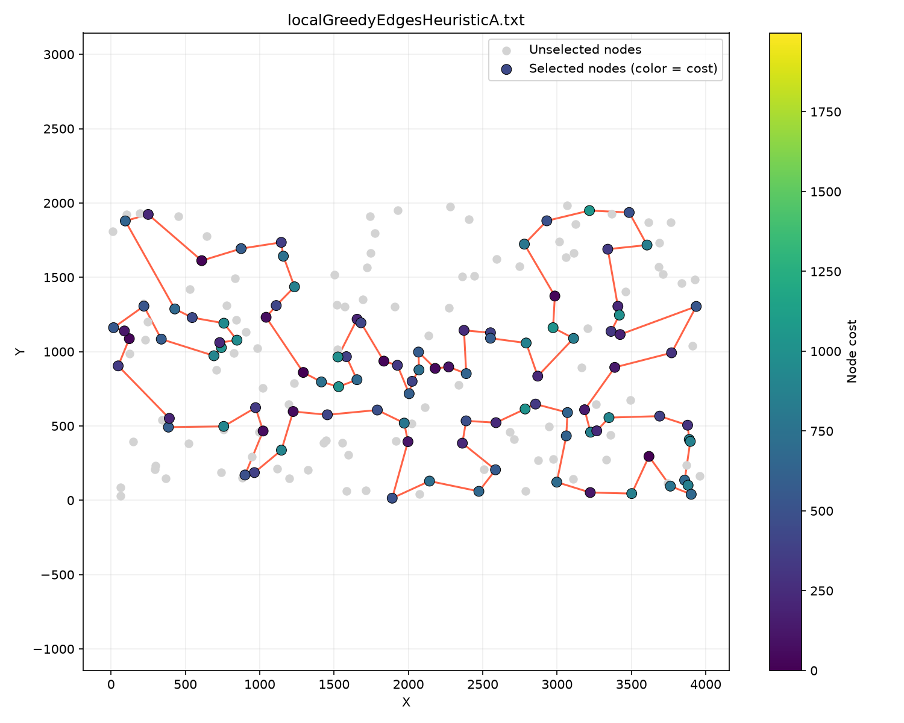

```
152 108 31 48 80 91 157 71 4 76 132 180 28 102 185 35 156 51 16 67 144 140 53 179 52 177 36 131 33 9 54 8 174 85 142 164 186 136 163 29 101 178 1 169 3 50 147 47 93 106 42 89 113 130 159 146 170 153 193 78 88 107 64 57 182 151 150 176 72 134 84 58 158 192 181 114 135 73 45 87 141 189 2 171 187 30 161 127 97 168 63 149 116 60 49 160 83 123 90 100
```

#### Heuristic initial solution - TSPB

Max objective: 60241<br>
Average objective: 55314<br>
Min objective: 51975<br>
Runtime: 0.220489 s

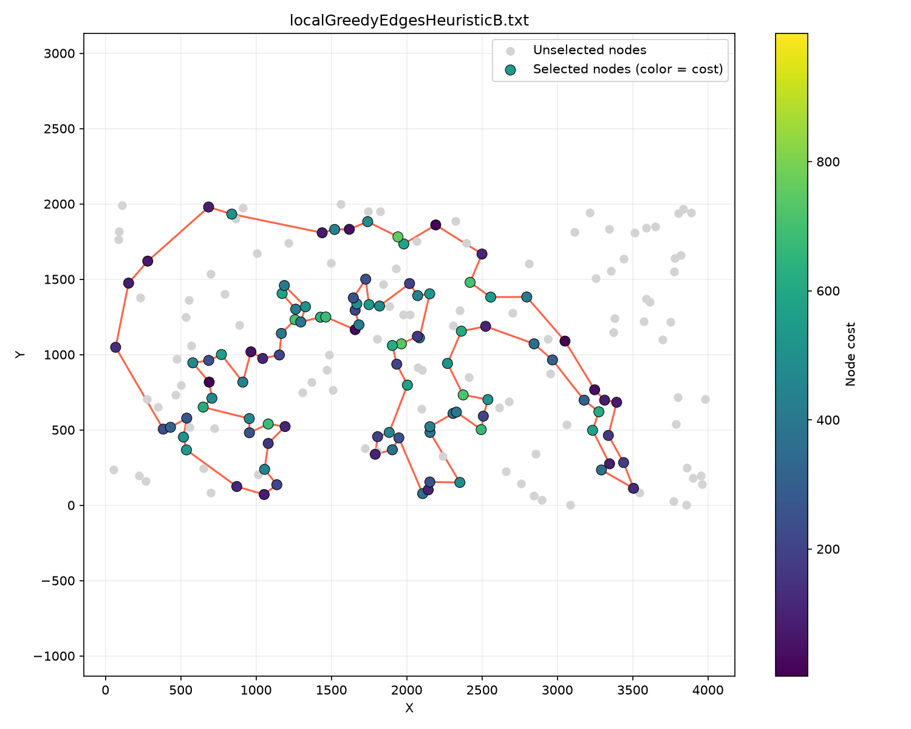

```
36 175 134 45 157 60 40 141 71 155 180 115 170 177 125 26 97 154 140 47 38 176 30 191 130 183 21 189 168 69 160 172 136 133 120 8 117 72 46 86 3 184 173 122 151 98 73 59 85 51 167 82 87 179 88 181 152 34 24 31 67 66 11 27 135 76 162 192 80 52 182 20 74 2 14 153 90 129 127 54 104 185 79 57 89 156 43 48 96 198 121 147 116 149 28 65 132 29 6 197
```

### Local search greedy nodes

```
solution = initial_algorithm()
bool[200] contains
populate contains with all nodes in solution

vector<array[2]> nodeSwapPoolInter
populate with all possible node swaps

vector<array[2]> nodeSwapPoolIntra
populate with all possible node swaps

while at least one pool is not empty{
    improved = false
    choice = randomly pick 0 or 1
    if (choice == 1 and nodeSwapPoolInter not empty){
        randomly pick index from 0 to nodeSwapPoolInter.size - 1
        fetch and pop selected swap from the pool
        calculate delta
        if (delta < 0){
            replace node in solution
            update contains
            improved = true
        }
    }
    else{
        if(nodeSwapPoolIntra not empty){
            randomly pick index from 0 to nodeSwapPoolIntra.size - 1
            fetch and pop selected swap from the pool
            calculate delta
            if (delta < 0){
                swap nodes in solution
                improved = true
            }
        }
    }
    if (improved){
        clear and reset both pools
    }
}
return solution
```

#### Random initial solution - TSPA

Max objective: 93632<br>
Average objective: 87865<br>
Min objective: 80627<br>
Runtime: 1.07035 s


```
176 134 84 131 143 62 186 136 29 178 1 47 153 78 88 64 57 182 192 181 114 98 189 187 30 141 87 45 41 140 53 177 36 54 194 8 174 72 158 58 135 73 185 35 156 28 180 76 4 71 157 115 112 139 51 132 63 149 116 60 108 152 100 123 160 49 168 97 127 69 171 2 161 90 38 80 31 7 48 91 16 67 144 179 52 33 9 164 85 3 50 93 106 130 159 107 89 42 151 150
```

#### Random initial solution - TSPB

Max objective: 70609<br>
Average objective: 64189<br>
Min objective: 58613<br>
Runtime: 1.06005 s

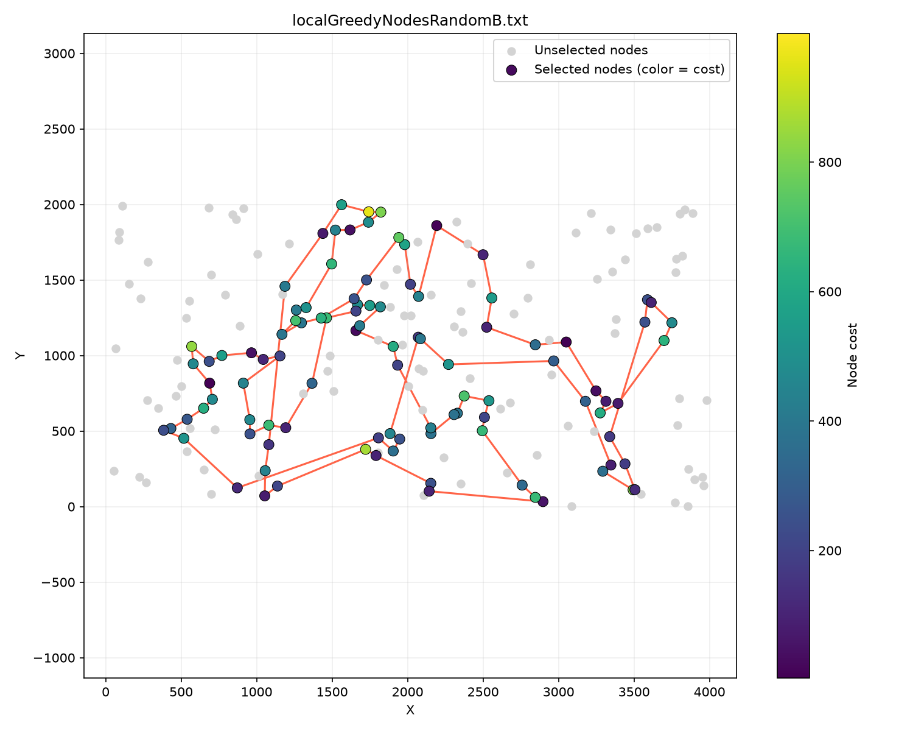

```
69 160 117 8 136 172 168 64 40 141 71 155 97 47 140 154 26 125 55 177 170 115 180 6 29 132 197 175 59 51 167 73 184 3 27 192 80 20 74 188 2 14 153 10 196 114 148 143 90 52 129 127 54 162 76 185 57 89 46 72 156 43 120 133 189 21 38 176 30 183 63 198 96 48 164 16 58 121 130 60 157 134 45 107 85 179 87 171 39 99 31 67 66 11 24 34 181 152 151 122
```

#### Heuristic initial solution - TSPA

Max objective: 74658<br>
Average objective: 73114<br>
Min objective: 72261<br>
Runtime: 0.275943 s


```
174 8 54 9 33 131 36 177 52 179 53 140 144 67 16 51 156 35 185 102 28 180 132 76 4 71 157 91 80 48 31 108 60 116 149 63 168 95 127 97 49 152 100 90 123 83 160 30 187 171 2 189 141 87 45 73 135 114 181 192 158 58 84 134 72 176 150 106 113 89 42 151 138 182 57 64 107 88 78 193 153 170 146 159 130 47 93 50 3 169 1 178 101 29 163 136 186 164 142 85
```

#### Heuristic initial solution - TSPB

Max objective: 61478<br>
Average objective: 55636<br>
Min objective: 52247<br>
Runtime: 0.308007 s


```
17 171 39 99 88 87 82 179 51 85 59 73 167 181 152 34 24 31 67 66 27 111 98 151 122 69 160 172 136 133 168 189 21 47 140 97 141 40 60 157 45 134 175 71 155 115 180 6 197 36 29 132 103 178 19 170 177 125 26 154 38 176 183 30 191 130 121 198 96 48 89 156 120 8 117 72 46 86 184 3 135 76 185 57 104 162 54 192 80 127 129 90 52 182 153 74 20 14 110 2
```

### Local search steepest edges

```
solution = initial_algorithm()
bool[200] contains
populate contains with all nodes in solution

vector<array[2]> nodeSwapPoolInter
populate with all possible node swaps

vector<array[4]> edgeSwapPool
populate with all possible edge swaps

while true{
    bestDelta = 0
    bestIdx = 0
    isInterBest = false
    for idx from 0 to nodeSwapPoolInter.size {
        fetch selected swap from the pool
        calculate delta
        if (delta > bestDelta){
            bestIdx = idx
            isInterbest = true
            bestDelta = delta
        }
    }
    for idx from 0 to edgeSwapPool.size {
        fetch selected swap from the pool
        calculate delta
        if (delta > bestDelta){
            bestIdx = idx
            isInterbest = false
            bestDelta = delta
        }
    }
    if (bestDelta < 0){
        if(isInterbest){
            perform swap from nodeSwapPoolInter[bestIdx]
            update contains
        }
        else{
            perform swap from edgeSwapPool[bestIdx]
        }
        clear and reset both pools
    }
    else break
}
return solution
```

#### Random initial solution - TSPA

Max objective: 79004<br>
Average objective: 76344<br>
Min objective: 73968<br>
Runtime: 0.771506 s

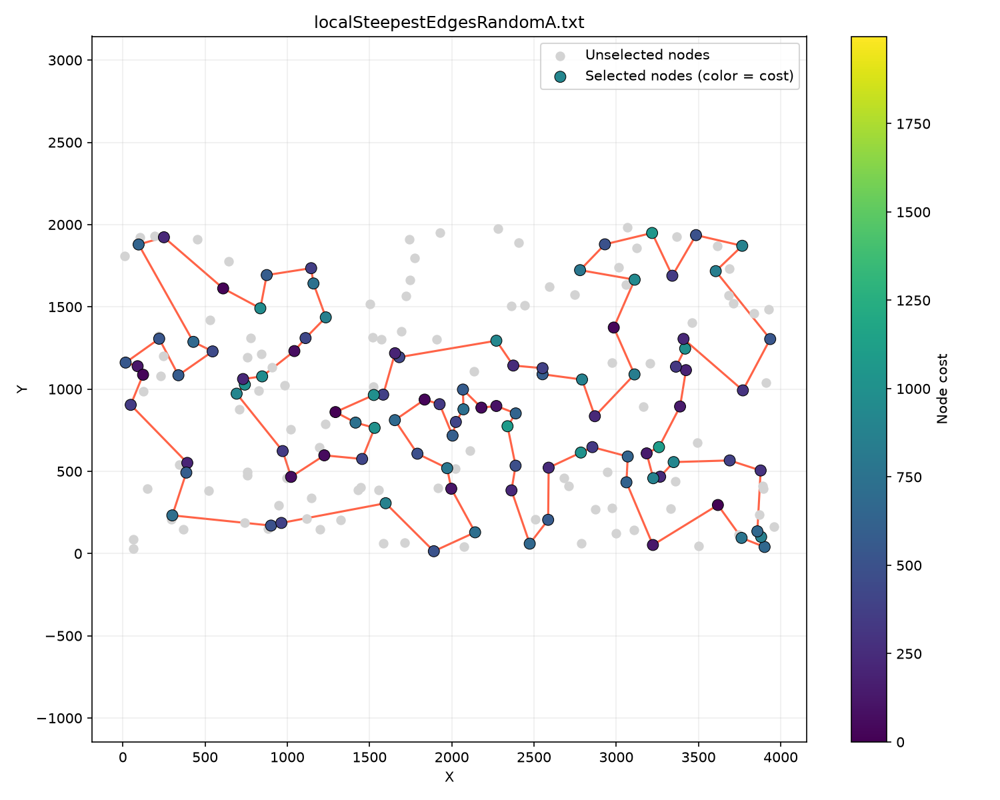

```
113 89 42 106 43 93 50 3 169 1 47 147 101 55 29 178 163 136 186 184 164 85 174 8 54 9 33 143 16 51 35 156 180 28 102 87 141 187 30 160 83 123 90 132 76 4 71 157 91 38 80 48 31 108 152 49 60 116 149 63 168 97 127 69 171 2 98 114 181 135 73 45 185 67 144 140 53 179 52 177 36 131 99 84 58 192 158 134 72 176 150 151 57 107 88 78 193 153 159 130
```

#### Random initial solution - TSPB

Max objective: 54536<br>
Average objective: 52345<br>
Min objective: 50554<br>
Runtime: 0.639972 s

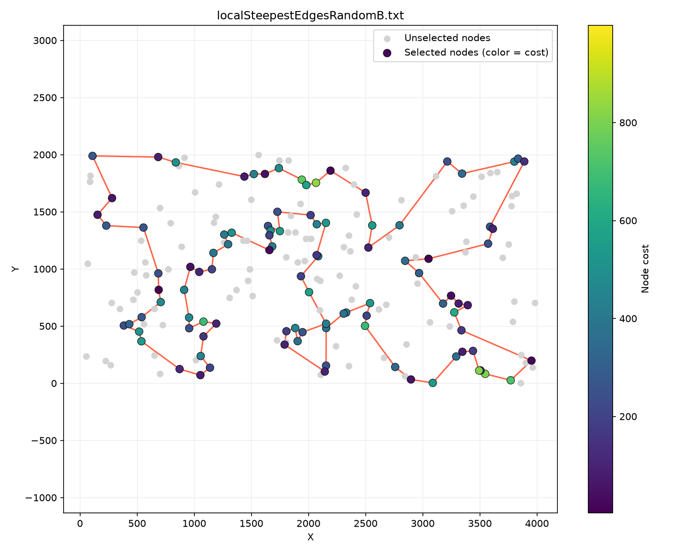

```
110 93 9 2 188 14 20 74 17 171 99 31 67 66 24 34 181 179 87 85 59 73 51 167 152 98 151 3 184 86 46 72 120 8 133 136 172 160 69 183 30 21 38 47 140 154 97 155 71 141 40 60 157 45 134 175 36 197 132 29 6 115 170 125 158 145 28 149 37 116 147 121 198 96 48 43 156 32 89 57 185 76 104 190 70 81 94 105 196 114 10 54 162 192 80 127 129 90 52 153
```

#### Heuristic initial solution - TSPA

Max objective: 74466<br>
Average objective: 72981<br>
Min objective: 72192<br>
Runtime: 0.153551 s


```
152 108 31 48 80 91 157 71 4 76 132 180 28 102 185 35 156 51 16 67 144 140 53 179 52 177 36 131 33 9 54 8 174 85 142 164 186 136 163 29 101 178 1 169 3 50 147 47 93 106 42 89 113 130 159 146 170 153 193 78 88 107 64 57 182 151 150 176 72 134 84 58 158 192 181 114 135 73 45 87 141 189 2 171 187 30 161 127 97 168 63 149 116 60 49 160 83 123 90 100
```

#### Heuristic initial solution - TSPB

Max objective: 60144<br>
Average objective: 55312<br>
Min objective: 52166<br>
Runtime: 0.160574 s

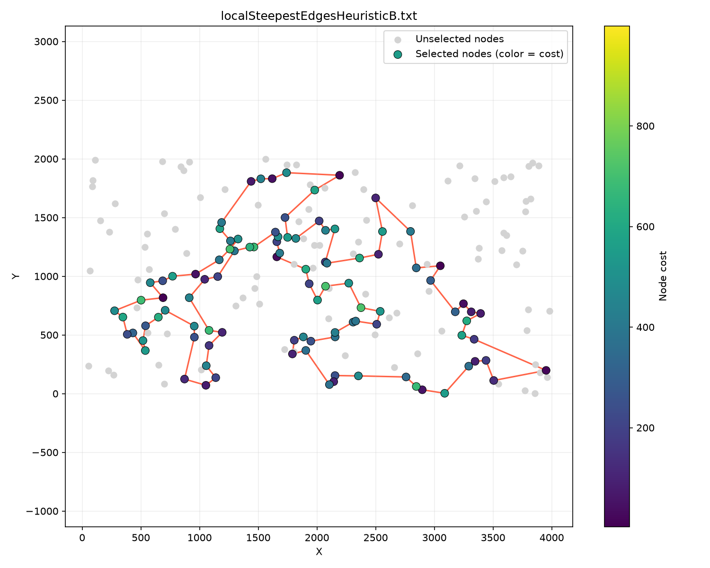

```
17 171 39 99 88 179 87 82 51 85 59 73 167 181 152 34 24 67 66 11 27 111 98 151 122 69 160 172 136 133 168 189 21 47 140 97 141 40 60 157 45 134 175 71 155 115 180 6 197 36 29 132 103 178 19 170 177 125 26 154 38 176 183 30 191 130 121 198 96 48 89 156 120 8 117 72 46 86 184 3 135 76 185 57 104 162 54 192 80 127 129 90 52 182 153 110 2 14 20 74
```

### Local search steepest nodes

```
solution = initial_algorithm()
bool[200] contains
populate contains with all nodes in solution

vector<array[2]> nodeSwapPoolInter
populate with all possible node swaps

vector<array[2]> nodeSwapIntra
populate with all possible node swaps

while true{
    bestDelta = 0
    bestIdx = 0
    isInterBest = false
    for idx from 0 to nodeSwapPoolInter.size {
        fetch selected swap from the pool
        calculate delta
        if (delta > bestDelta){
            bestIdx = idx
            isInterbest = true
            bestDelta = delta
        }
    }
    for idx from 0 to nodeSwapIntra.size {
        fetch selected swap from the pool
        calculate delta
        if (delta > bestDelta){
            bestIdx = idx
            isInterbest = false
            bestDelta = delta
        }
    }
    if (bestDelta < 0){
        if(isInterbest){
            perform swap from nodeSwapPoolInter[bestIdx]
            update contains
        }
        else{
            perform swap from nodeSwapIntra[bestIdx]
        }
        clear and reset both pools
    }
    else break
}
return solution
```

#### Random initial solution - TSPA

Max objective: 98326<br>
Average objective: 89686<br>
Min objective: 82908<br>
Runtime: 1.08513 s

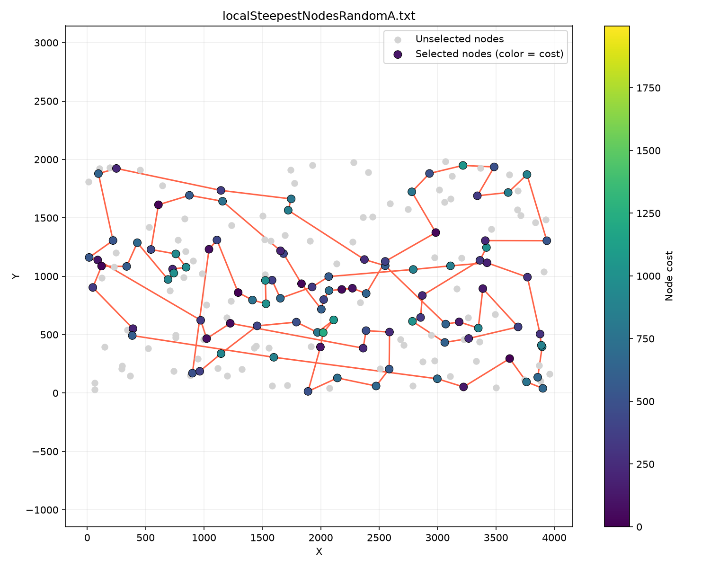

```
135 114 181 192 158 134 84 58 141 187 30 149 116 60 31 48 157 112 139 33 54 150 106 113 93 130 89 151 72 176 174 3 169 1 147 55 101 178 29 163 136 186 164 9 131 36 177 179 53 140 67 16 51 71 91 80 152 100 90 123 83 160 108 49 63 168 97 127 98 182 57 107 88 78 153 170 146 159 47 50 85 8 52 144 185 35 156 102 28 180 76 132 171 2 189 87 45 73 41 61
```

#### Random initial solution - TSPB

Max objective: 74250<br>
Average objective: 65952<br>
Min objective: 58036<br>
Runtime: 0.974931 s

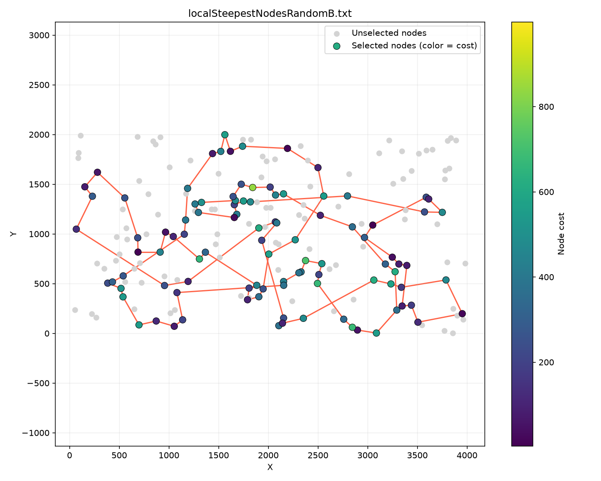

```
52 74 17 171 39 99 31 67 66 11 24 34 152 181 60 45 134 175 62 36 197 132 29 6 47 38 130 121 198 58 96 48 89 57 185 27 98 167 51 85 59 73 64 33 140 154 97 170 125 158 149 28 145 65 71 40 122 184 3 151 179 82 87 88 150 182 153 118 110 2 14 20 90 129 127 192 54 196 114 148 10 104 117 8 172 160 69 21 30 183 136 133 120 92 72 46 86 76 162 80
```

#### Heuristic initial solution - TSPA

Max objective: 74658<br>
Average objective: 73106<br>
Min objective: 72261<br>
Runtime: 0.247594 s

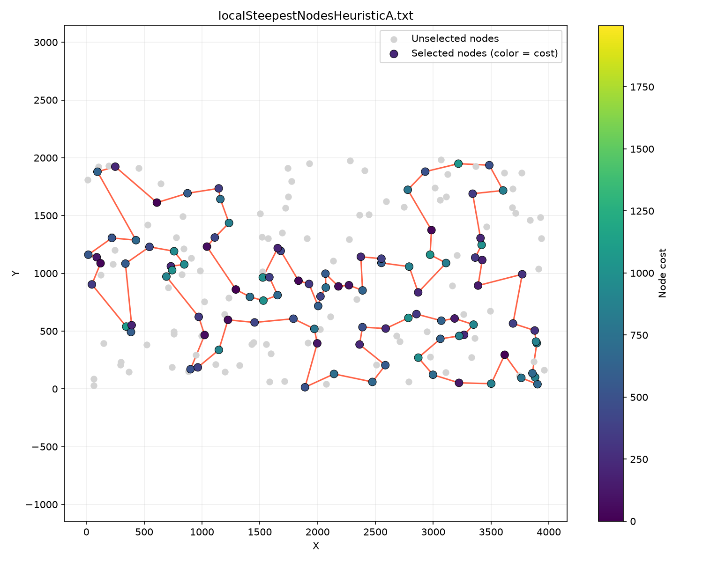

```
174 8 54 9 33 131 36 177 52 179 53 140 144 67 16 51 156 35 185 102 28 180 132 76 4 71 157 91 80 48 31 108 60 116 149 63 168 95 127 97 49 152 100 90 123 83 160 30 187 171 2 189 141 87 45 73 135 114 181 192 158 58 84 134 72 176 150 106 113 89 42 151 138 182 57 64 107 88 78 193 153 170 146 159 130 47 93 50 3 169 1 178 101 29 163 136 186 164 142 85
```

#### Heuristic initial solution - TSPB

Max objective: 61478<br>
Average objective: 55898<br>
Min objective: 52191<br>
Runtime: 0.265595 s


```
17 171 39 99 88 179 87 82 51 85 59 73 167 181 152 34 24 67 66 11 27 111 98 151 122 69 160 172 136 133 168 189 21 47 140 97 141 40 60 157 45 134 175 71 155 115 180 6 197 36 29 132 103 178 19 170 177 125 26 154 38 176 183 30 191 130 121 198 96 48 89 156 120 8 117 72 46 86 184 3 135 76 185 57 104 162 54 192 80 127 129 90 52 182 153 74 20 14 110 2
```

## All scores so far

| Algorithm                           |  TSPA max | TSPA average |  TSPA min | TSPA runtime (s) |  TSPB max | TSPB average |  TSPB min | TSPB runtime (s) |
| ----------------------------------- | --------: | -----------: | --------: | ---------------: | --------: | -----------: | --------: | ---------------: |
| Random                              |    273658 |       255106 |    234696 |                - |    221369 |       213252 |    196792 |                - |
| Nearest neighbour end only          |     90075 |        87476 |     84362 |                - |     63166 |        59397 |     56007 |                - |
| Nearest neighbour all possibilities |     76623 |        74707 |     73176 |                - |     67192 |        60635 |     56001 |                - |
| Greedy cycle                        |     75281 |        73743 |     72590 |                - |     63734 |        59650 |     55655 |                - |
| Nearest neighbour 2-regret          |     77022 |        74306 |     72328 |                - |     66164 |        59476 |     52915 |                - |
| Greedy cycle 2-regret               |     75585 |        73817 |     72886 |                - |     63641 |        59371 |     53245 |                - |
| Nearest neighbour 2-regret weighted |     77755 |        74513 |     72505 |                - |     61579 |        57535 |     52646 |                - |
| Greedy cycle 2-regret weighted      |     75132 |        73396 |     72430 |                - |     63770 |        58195 |     52834 |                - |
| Local greedy edges random           |     79550 |        76462 |     73699 |          1.19438 |     55870 |        53075 |     50767 |          1.03015 |
| Local greedy edges heuristic        |     74487 |    **72968** | **72192** |         0.176329 |     60241 |        55314 |     51975 |         0.220489 |
| Local greedy nodes random           |     93632 |        87865 |     80627 |          1.07035 |     70609 |        64189 |     58613 |          1.06005 |
| Local greedy nodes heuristic        |     74658 |        73114 |     72261 |         0.275943 |     61478 |        55636 |     52247 |         0.308007 |
| Local steepest edges random         |     79004 |        76344 |     73968 |         0.771506 | **54536** |    **52345** | **50554** |         0.639972 |
| Local steepest edges heuristic      | **74466** |        72981 | **72192** |     **0.153551** |     60144 |        55312 |     52166 |     **0.160574** |
| Local steepest nodes random         |     98326 |        89686 |     82908 |          1.08513 |     74250 |        65952 |     58036 |         0.974931 |
| Local steepest nodes heuristic      |     74658 |        73106 |     72261 |         0.247594 |     61478 |        55898 |     52191 |         0.265595 |

## Conclusions

Overall, implementing local search nicely improves scores all across the board. Even initially random solutions are capable of yielding surprisingly decent results after substantial neighbourhood exploration.
<br><br>
There is a noticeable time difference for both greedy and steepest approaches, where starting out with a random solution vastly increases the runtime due to a much longer search.
<br><br>
For TSPA, the best approach turned out to be local steepest edges with a heuristic, but the minimal objective ended up actually being tied with the greedy variant of the same approach.
<br><br>
For TSPB, surprisingly, the best solution ended up being derived from a random one using the local steepest edges. That fluke aside, the best heuristic-derived score ended up being a result of local greedy edges.
