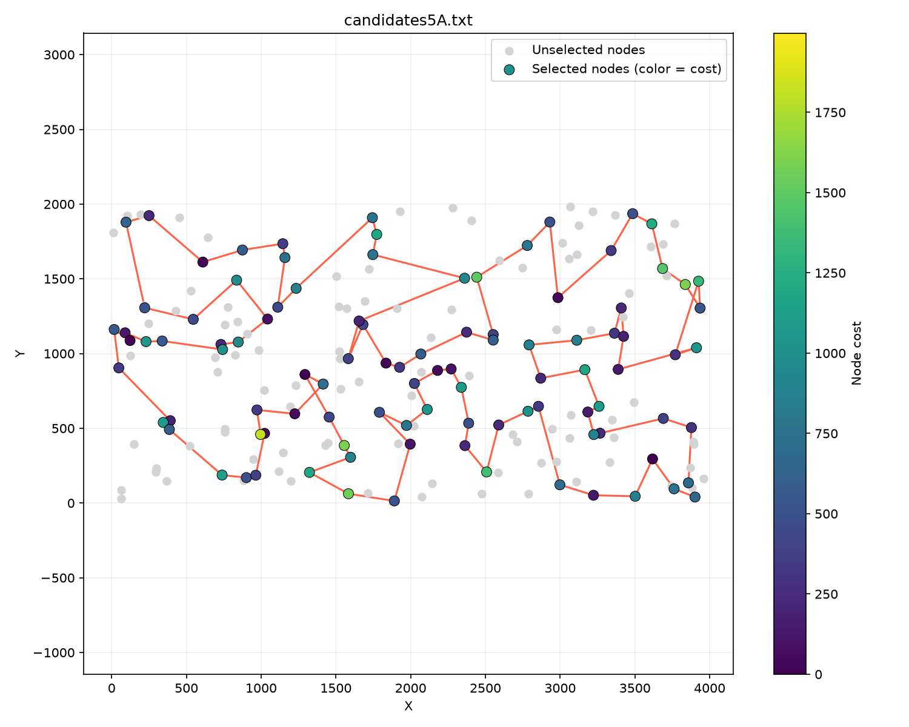
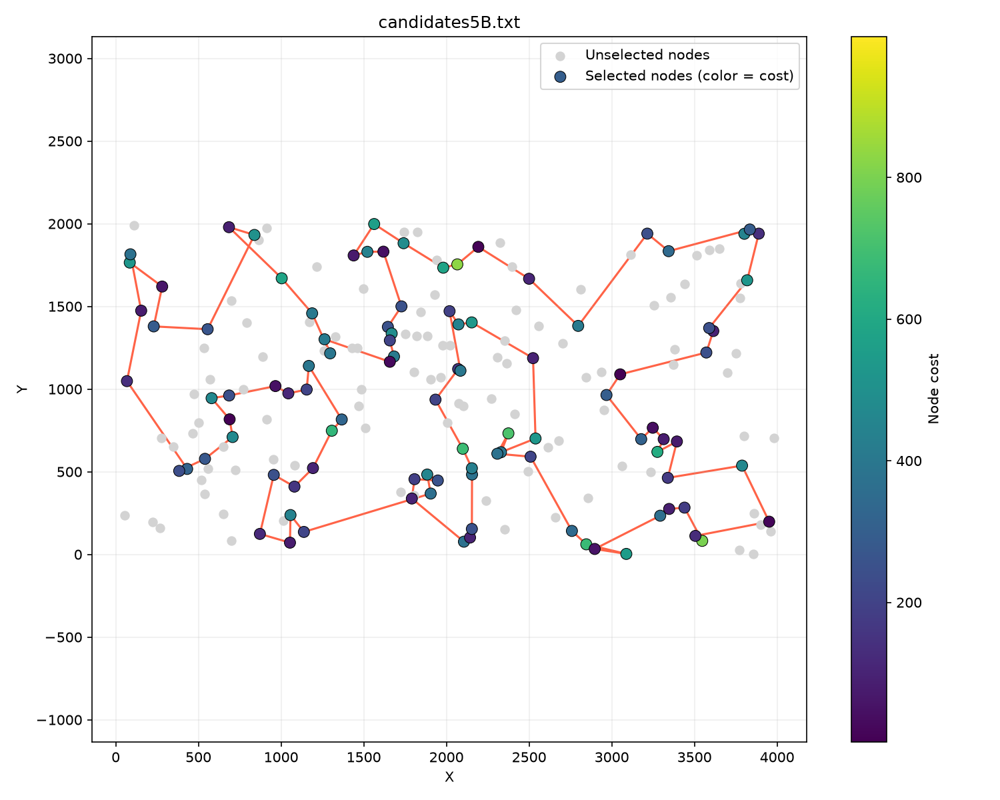
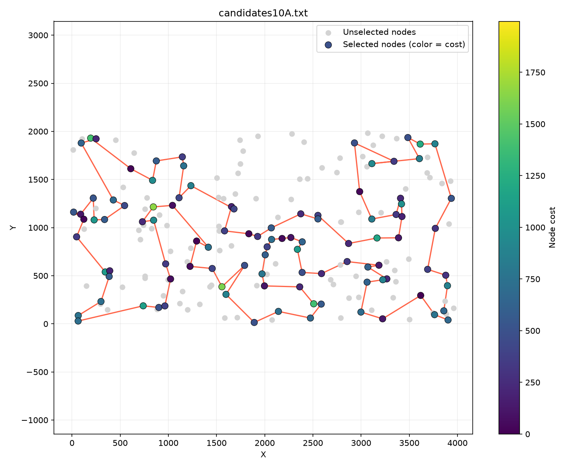
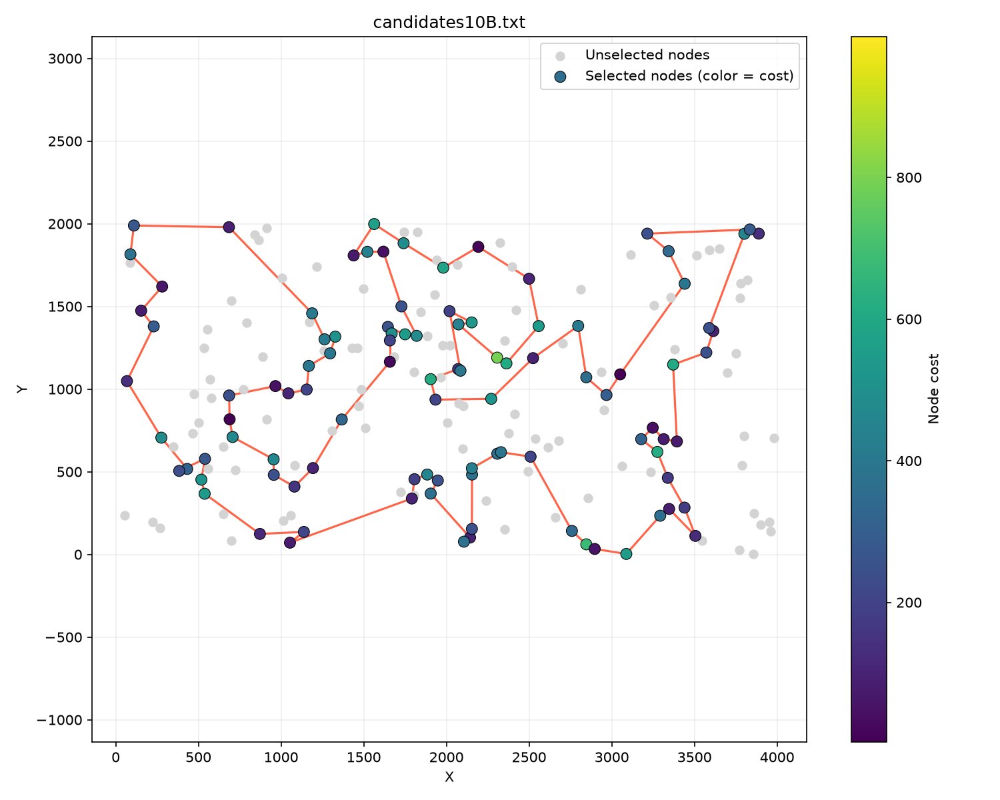
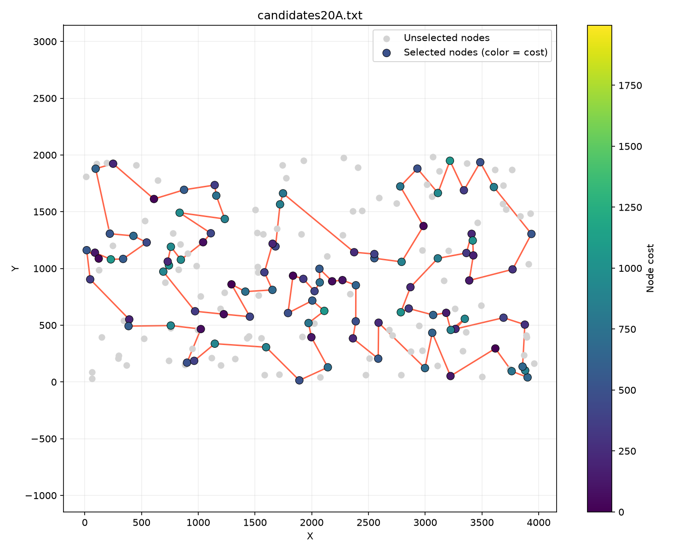
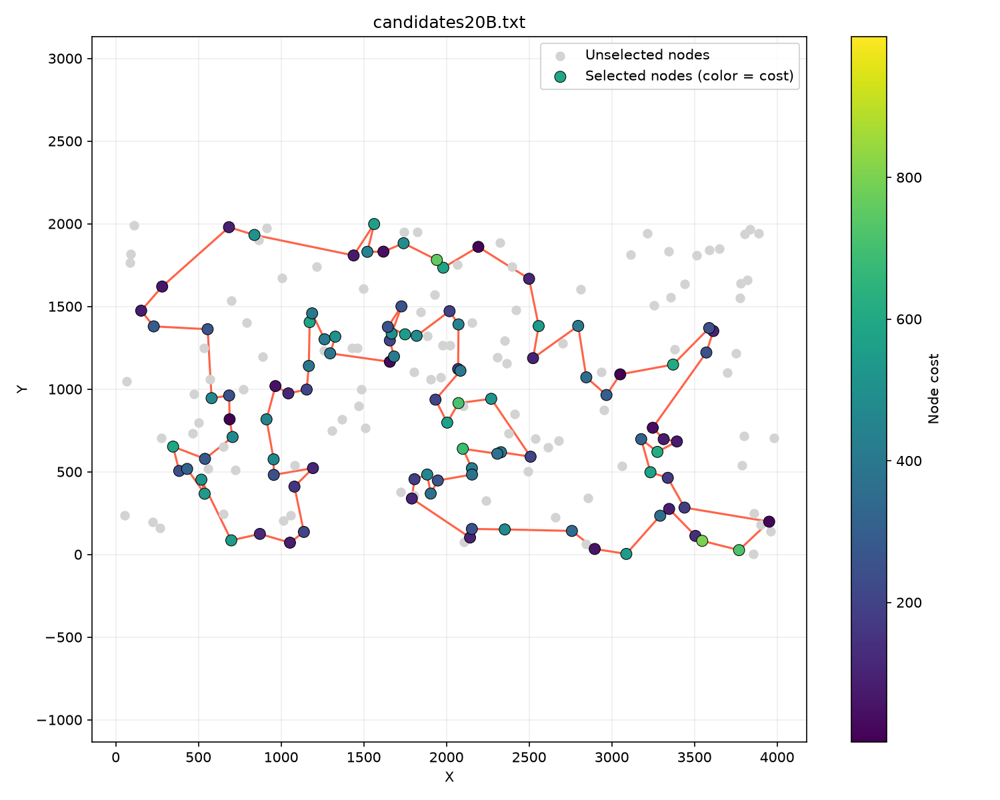

# Local search with candidate edges

### Hubert Nowakowski 160302

### Muhammad Sattorov 159351

### Code link: https://github.com/hnowakowski/Evolutionary-Computation-2026/blob/main/4_candidates/main.cpp

## Description of the problem

We're trying to find a hamiltonian cycle where:

- function to be minimized is defined as distance + cost
- we want to have the cycle consist of exactly 50% of nodes
- distances between nodes are rounded euclidean

All solutions are described as a vector of subsequent node indices, their objectives were tested using the solution checker excel sheet

For random solutions the std::mt19937 random number generator was used

## Psuedocode

```
NEAREST_CNT = 10
sol = initial_algorithm()
array[200] solLookup
fill solLookup with -1
for i in range(0, sol.size){
    solLookup[sol[i]] = i
}

array[200][199] nearestTemp
array[200][NEAREST_CNT] nearest
for i in range(0, 200):
    for j in range(0, 199):
        if (j == i) continue
        if (j > i) nearestTemp[i][j-1] = j
        else nearestTemp[i][j] = j

for i in range(0, 200):
    sort nearestTemp[i] by objective in ascending order
    for j in range(0, NEAREST_CNT):
        nearest[i][j] = nearestTemp[i][j];

vector<array[2]> nodeSwapPoolInter
for i in range(0, 200):
    if solLookup[i] == -1 continue
    iSolIdx = solLookup[i]
    beforeI = (iSolIdx == 0) ? sol.size() - 1 : iSolIdx - 1
    afterI = (iSolIdx == sol.size() - 1) ? 0 : iSolIdx + 1
    for j in nearest[sol[beforeI]]:
        if solLookup[j] != -1 continue
        nodeSwapPoolInter.emplace_back(i, j)
    for j in nearest[sol[afterI]]:
        if solLookup[j] != -1 continue
        nodeSwapPoolInter.emplace_back(i, j)

vector<array[4]> edgeSwapPool
for i in range(0, sol.size()):
    j = (i == sol.size() - 1) ? 0 : i + 1
    beforeI = (i == 0) ? (sol.size() - 1) : i - 1
    for k in nearest[sol[i]]:
        if solLookup[k] == -1 continue
        beforeK = (kIdx == 0) ? (sol.size() - 1) : kIdx - 1
        l = (kIdx == sol.size() - 1) ? 0 : kIdx + 1
        if l != beforeI && j != beforeK && kIdx != j:
		    edgeSwapPool.emplace_back(sol[i], sol[j], sol[kIdx], sol[l])

while true:
    bestDelta = 0
    bestIdx = 0
    isInterBest = false
    for idx from 0 to nodeSwapPoolInter.size:
        fetch selected swap from the pool
        calculate delta
        if (delta > bestDelta):
            bestIdx = idx
            isInterbest = true
            bestDelta = delta

    for idx from 0 to edgeSwapPool.size:
        fetch selected swap from the pool
        calculate delta
        if (delta > bestDelta):
            bestIdx = idx
            isInterbest = false
            bestDelta = delta

    if (bestDelta < 0):
        if(isInterbest):
            perform swap from nodeSwapPoolInter[bestIdx]
            update solLookup
        else:
            perform swap from edgeSwapPool[bestIdx]

        clear and reset both pools
    else break

return solution
```

### Candidates: 5

#### TSPA

Max objective: 96792<br>
Average objective: 90444<br>
Min objective: 85663<br>
Elapsed: 1.97878 seconds



#### TSPB

Max objective: 59453<br>
Average objective: 55955<br>
Min objective: 52900<br>
Elapsed: 1.97842 seconds



### Candidates: 10

#### TSPA

Max objective: 86959<br>
Average objective: 81890<br>
Min objective: 77930<br>
Elapsed: 2.67813 seconds



#### TSPB

Max objective: 56922<br>
Average objective: 53767<br>
Min objective: 51171<br>
Elapsed: 2.76157 seconds



### Candidates: 20

#### TSPA

Max objective: 81108<br>
Average objective: 77937<br>
Min objective: 75343<br>
Elapsed: 4.20468 seconds



#### TSPB

Max objective: 56060<br>
Average objective: 53305<br>
Min objective: 51171<br>
Elapsed: 4.51270 seconds



## Scores

Time is the full execution time in seconds of 200 runs on a single thread.

| Algo name         |          average TSPA (min - max) |   TSPA time |          average TSPB (min - max) |   TSPB time |
| ----------------- | --------------------------------: | ----------: | --------------------------------: | ----------: |
| Local search 5    |             90444 (85663 - 96792) | **1.97878** |             55955 (52900 - 59453) | **1.97842** |
| Local search 10   |             81890 (77930 - 86959) |     2.67813 |             53767 (51171 - 56922) |     2.76157 |
| Local search 20   |             77937 (75343 - 81108) |     4.20468 |             53305 (51171 - 56060) |     4.51270 |
| Local search full | **76344** (**73968** - **79004**) |     4.77540 | **52345** (**50554** - **54536**) |     4.95898 |

## Conclusions

10 candidates appears to be a decent middle ground of performance to speed - it's roughly twice as fast with pretty decent results.<br><br>
20 candidates variant is well into diminishing returns territory, with the overhead approaching the base version's speed, while not providing much better results than the 10 candidates version, for TSPB especially, where the minimum found is the same.<br><br>
The 5 candidates version is much faster, but also much worse - especially for TSPA.<br><br>
As a whole, TSPB scores appear much more smooth without a large difference between 10 and 20, while in TSPA there's a performance cliff between all three variants.
