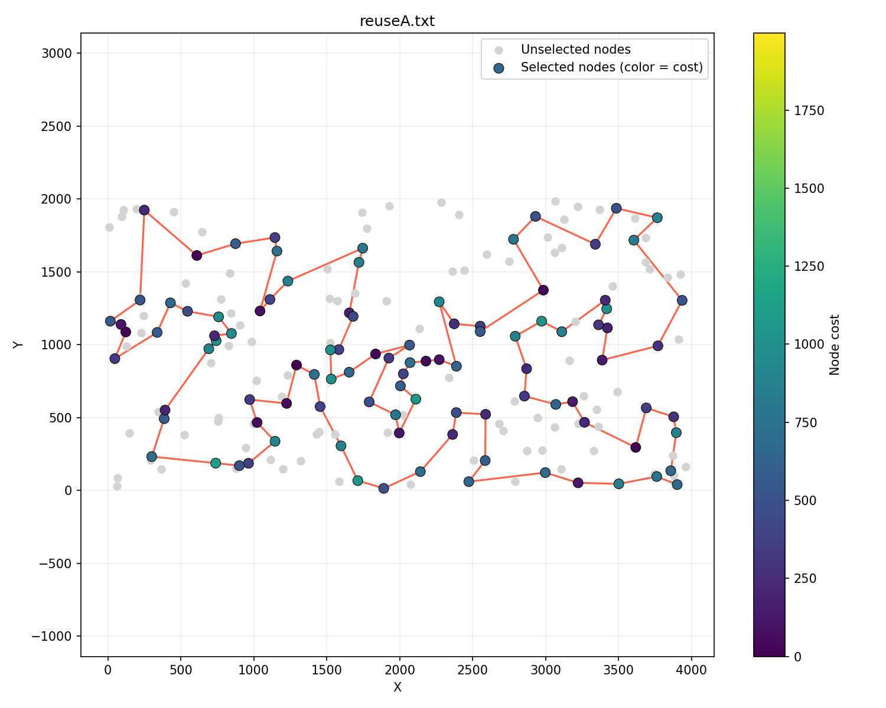
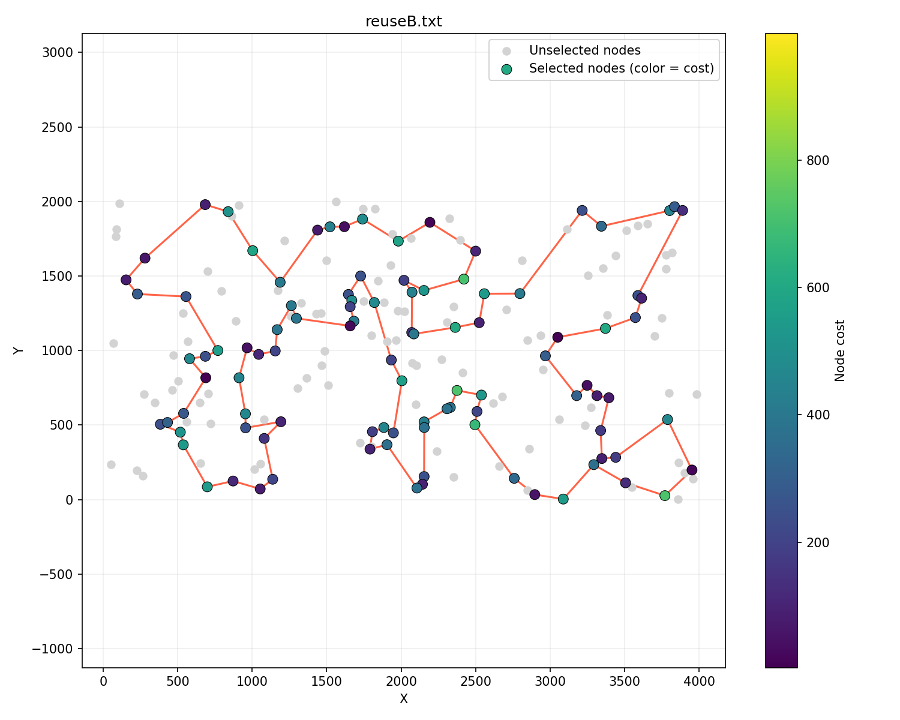

# Local search with reusing moves

### Hubert Nowakowski 160302

### Muhammad Sattorov 159351

### Code link: https://github.com/hnowakowski/Evolutionary-Computation-2026/blob/main/5_reuse/main.cpp

## Description of the problem

We're trying to find a hamiltonian cycle where:

- function to be minimized is defined as distance + cost
- we want to have the cycle consist of exactly 50% of nodes
- distances between nodes are rounded euclidean

All solutions are described as a vector of subsequent node indices, their objectives were tested using the solution checker excel sheet

For random solutions the std::mt19937 random number generator was used

## Psuedocode

### Definition of a move

Since we're keeping both types of moves in one pool, we need them to be directly comparable.<br><br>
We're also storing info about original successors and predecessors for node swaps, so that it's easier to check if a move is still valid.<br><br>
Delta is only ever calculated when creating a move object ie. when discovering a new improving move and adding it into the pool.<br><br>
Delta is the comparison operator for the minheap.<br><br>

```
struct Move:
    bool isEdge
    # for edges it's just i, j, k, l indices
    # for nodes it's 0: old, 1: new, 2: old predecessor, 3: old successor
    array[4] swap
    int delta

    node swap constructor:
        iIdx = solLookup[i]
        beforeI = (iIdx == 0) ? sol.size() - 1 : iIdx - 1
        afterI = (iIdx == sol.size() - 1) ? 0 : iIdx + 1
        swap = {i, j, sol[beforeI], sol[afterI]}
        delta = interNodeSwapDelta(matrix, sol, nodes, solLookup, i, j)
        isEdge = false

    edge swap contructor:
        swap = { i, j, k, l }
        delta = edgeSwapDelta(matrix, sol, i, j, k, l)
        isEdge = true
```

### Helper for edge direction

Since the direction of an edge `i - j` is a frequently brought up issue, we have a small helper function. <br><br>
In short, it returns 1 if the edge is its original state, -1 if it's reversed, and 0 if it does not exist anymore.

```
edgeState:
    idxI = solLookup[i]
    idxJ = solLookup[j]
    if idxI == -1 || idxJ == -1: return 0
    afterI = (idxI == sol.size() - 1) ? 0 : idxI + 1
    afterJ = (idxJ == sol.size() - 1) ? 0 : idxJ + 1
    if idxJ == afterI: return 1
    if idxI == afterJ: return -1
    return 0
```

### Algorithm

```
sol = initial_algorithm()
array[200] solLookup
fill solLookup with -1
for i in range(0, sol.size):
    solLookup[sol[i]] = i

priority_queue<Move> movePool
for i in range(0, sol.size):
	for j in range(0, 200):
		if (solLookup[j] != -1) continue
			m = Move(sol[i], j)
			if (m.delta < 0) movePool.emplace(m)

for i in range(0, sol.size()):
	j = (i == sol.size() - 1) ? 0 : i + 1
	for k in range(i + 2, sol.size()):
        l = (k == sol.size() - 1) ? 0 : k + 1
        if (i == 0 && l == 0) continue
        m = Move(sol[i], sol[j], sol[k], sol[l])
        if (m.delta < 0) movePool.emplace(m)

vector<Move> reservePool
while true:
    foundUsable = false
    while !movePool.empty:
        m = movePool.top
        i, j, k, l = m.swap
        if !m.isEdge:
            # nodes missing in sol (or j present)
            if solLookup[i] == -1 || solLookup[j] != -1 || solLookup[k] == -1 || solLookup[l] == -1:
                movePool.pop()
                continue

            # adjacent edges missing
            beforeI = (solLookup[i] == 0) ? sol.size() - 1 : solLookup[i] - 1
            afterI = (solLookup[i] == sol.size() - 1) ? 0 : solLookup[i] + 1
            if sol[beforeI] != k || sol[afterI] != l:
                movePool.pop()
                continue

            update solLookup
            movePool.pop()
            foundUsable = true
            break
        else:
            state1 = edgeState(i, j)
            state2 = edgeState(k, l)
            # edges missing in sol
            if state1 == 0 || state2 == 0:
                movePool.pop()
                continue;

            # one edge reversed one not
            if state1 != state2:
                movePool.pop()
                reservePool.emplace_back(m)
                continue

            if state1 == 1:
                sol.reverse(solLookup[j], solLookup[k])
                update solLookup
            else:
                sol.reverse(solLookup[k], solLookup[j])
                update solLookup
            movePool.pop()
            foundUsable = true
            break

    if foundUsable:
        for each m in reservePool:
            movePool.emplace(m)
        reservePool.clear()

    if !foundUsable:
        reservePool.clear()
        fill movePool as described above the loop

    if movePool.empty: break

return solution
```

## Scores

### TSPA

Max objective: 78864<br>
Average objective: 76420<br>
Min objective: 74117<br>
Elapsed: 1.35825 seconds



```
55 101 147 47 130 159 107 153 193 78 88 64 57 151 42 89 106 150 174 176 72 134 84 58 158 192 181 114 135 73 45 98 87 141 30 187 2 171 69 127 97 168 63 149 116 60 31 48 80 91 157 71 4 76 132 38 152 108 49 160 83 123 100 90 180 28 102 185 35 51 16 67 144 52 179 53 140 41 99 131 36 177 33 143 62 9 54 8 142 164 85 93 50 3 169 1 59 178 29 17
```

### TSPB

Max objective: 54890<br>
Average objective: 52486<br>
Min objective: 50570<br>
Elapsed: 1.29707 seconds



```
78 54 192 80 127 129 90 153 20 14 118 110 93 2 74 17 171 99 31 67 66 11 24 34 152 181 179 87 82 51 85 59 73 167 98 151 117 120 133 136 172 160 69 21 30 38 47 140 154 97 155 71 40 60 45 134 175 62 36 197 132 29 6 170 177 125 26 158 145 28 149 116 147 50 130 121 198 96 48 156 89 57 79 86 72 46 184 3 135 76 185 104 190 70 81 94 105 196 114 10
```

## Scores

Time is the full execution time in seconds of 200 runs on a single thread.

| Algo name          |          average TSPA (min - max) |   TSPA time |          average TSPB (min - max) |   TSPB time |
| ------------------ | --------------------------------: | ----------: | --------------------------------: | ----------: |
| Local search 5     |    90444 (85663 - 96792) |     1.97878 |             55955 (52900 - 59453) |     1.97842 |
| Local search 10    |    81890 (77930 - 86959) |     2.67813 |             53767 (51171 - 56922) |     2.76157 |
| Local search 20    |    77937 (75343 - 81108) |     4.20468 |             53305 (51171 - 56060) |     4.51270 |
| Local search reuse |    76420 (74117 - **78864**) | **1.35825** |             52486 (50570 - 54890) | **1.29707** |
| Local search full  | **76344** (**73968** - 79004) |     4.77540 | **52345** (**50554** - **54536**) |     4.95898 |

## Conclusions

By reusing moves, we were able to vastly decrease the running time of the algorithm, almost by 4 times, while only marginally decreasing scores.
<br><br>
In every instance, the reusing mechanism yielded much better results AND runtime than the candidates approach (aside from max score in TSPA).
<br><br>
For TSPB the difference between full and reusing approach is smaller, but for TSPA it's pretty decent as well.
