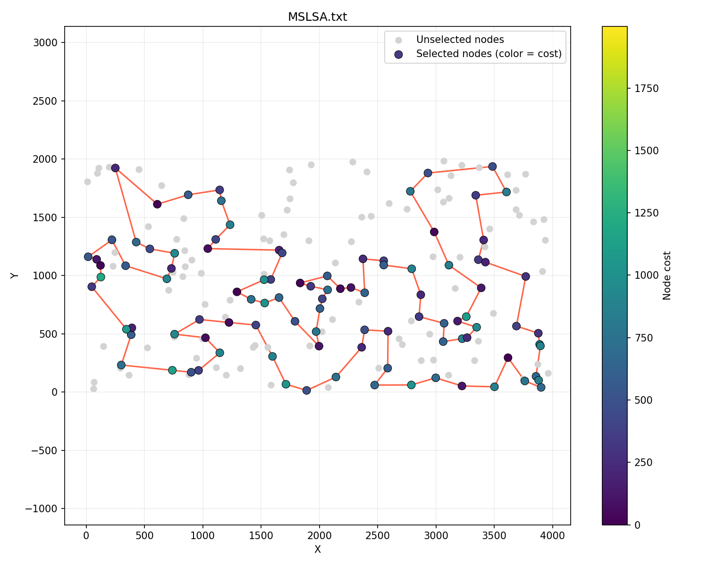
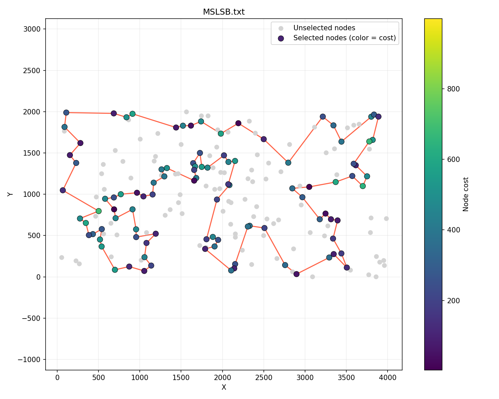
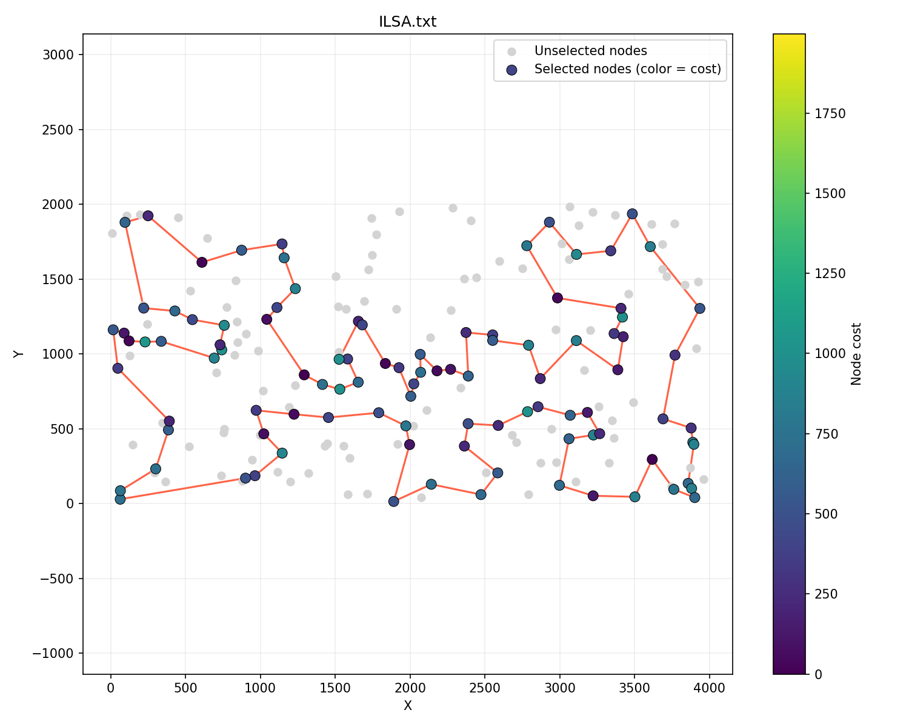
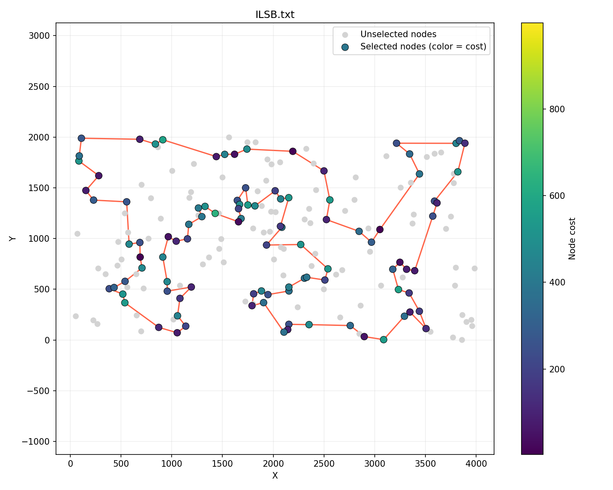

# MSLS & ILS

### Hubert Nowakowski 160302

### Muhammad Sattorov 159351

### Code link: https://github.com/hnowakowski/Evolutionary-Computation-2026/blob/main/6_MSLS_ILS/main.cpp

## Description of the problem

We're trying to find a hamiltonian cycle where:

- function to be minimized is defined as distance + cost
- we want to have the cycle consist of exactly 50% of nodes
- distances between nodes are rounded euclidean

All solutions are described as a vector of subsequent node indices, their objectives were tested using the solution checker excel sheet.

For random solutions the std::mt19937 random number generator was used.

Local search with reusing moves was used.

## Psuedocode

### MSLS

For randomizing solutions, the seed on the random number generator depends on the run (0 - 19) and iteration (0 - 399) to make sure we get a different solution each time. 

```
vector<int> bestSol
bestScore = 2^31 - 1
for i in range(0, 400):
    sol = randomSolution(seed = run * 400 + i)
    sol = localSearch()
    if sol.score < bestScore:
        bestScore = sol.score
        bestSol = sol
return bestSol
```

### Perturbation for ILS

As the perturbation we've decided to go with doing 4 random moves. The distribution used is `std::uniform_int_distribution` but in the pseudocode generating random ints is described as `randomInt()`, where both ends of the range are inclusive.
It's also worth noting that this function does not change the solution in-place, instead creating and modifying a copy.

```
for i in range(0, 4):
    type = randomInt(0, 1)
    # node
    if type == 0:
        i = randomInt(0, sol.size)
        j = randomInt(0, matrix.size)
        while j in sol || j == sol[i]:
            j = randomInt(0, matrix.size)
        replace i with j
    # edge
    else: 
        i = randomInt(0, sol.size - 6)
        j = i + 1
        k = randomInt(i + 2, sol.size() - 2)
        sol.reverse(j, k)

```

For i, the upper bound is sol.size - 6 specifically, since the closest possible edge swap to the end of the solution is:
`[..., i, j, skip, skip, k, l]`

### ILS

The time limit for each iteration is around 1.3ish seconds (calculated based on the MSLS running time).
Measured with `std::chrono`, for the pseudocode getting current timepoints are described as `time.now()`.
For randomizing solutions, the seed on the random number generator depends on the run (0 - 19).

```
start = time.now()
sol = randomSolution(seed = run)
bestScore = sol.score
runCnt = 0
while time.now() - start < TIME_LIMIT:
    tempSol = perturb(sol)
    tempSol = localSearch(tempSol)
    if tempSol.score < bestScore:
        sol = tempSol
        bestScore = score
    runCnt++
return sol
```

## Scores

### MSLS

#### TSPA

Max objective: 74050<br>
Average objective: 73630<br>
Min objective: 73285<br>
Elapsed: 65.7921 seconds



```
178 1 3 50 47 130 159 146 170 153 193 78 88 107 64 57 182 111 192 158 134 84 58 181 114 25 98 87 141 30 161 187 189 2 171 92 69 127 97 95 168 119 63 149 116 60 49 160 123 100 152 108 48 80 91 157 71 4 76 132 51 16 35 156 180 28 102 185 45 135 73 140 53 179 144 67 52 177 36 131 33 9 54 8 174 176 150 151 42 89 113 106 43 93 85 164 186 136 29 101
```

#### TSPB

Max objective: 50427<br>
Average objective: 50207<br>
Min objective: 49655<br>
Elapsed: 66.4933 seconds



```
114 148 143 10 78 54 162 192 80 127 129 90 153 14 2 20 74 171 99 67 24 34 179 87 82 85 51 167 73 59 151 3 184 86 46 72 117 8 120 133 136 172 160 69 183 30 21 38 47 140 154 26 125 177 170 115 97 155 71 40 60 157 45 134 175 62 36 197 6 29 132 103 178 19 65 145 28 149 146 37 116 147 42 121 198 96 48 156 89 57 104 190 70 187 81 94 105 61 139 196
```

### ILS

#### TSPA

Max objective: 72439<br>
Average objective: 71784<br>
Min objective: 71517<br>
Average runs: 1579<br>
Elapsed: 66.1774 seconds



```
87 141 30 187 189 2 171 104 129 69 127 97 168 116 149 63 11 49 160 83 123 100 152 108 60 31 48 80 91 157 71 4 76 132 180 28 102 185 35 156 51 16 67 144 140 53 179 52 177 36 131 33 9 54 8 174 85 93 50 3 169 1 164 186 136 184 178 29 101 147 47 130 159 146 170 153 193 78 88 107 64 57 182 151 42 89 106 150 176 72 134 84 58 158 192 181 114 135 73 45
```

#### TSPB

Max objective: 48919<br>
Average objective: 48486<br>
Min objective: 48195<br>
Average runs: 1588.35<br>
Elapsed: 66.1687 seconds



```
21 38 47 140 154 97 155 71 40 60 157 45 134 175 36 197 132 29 6 115 170 125 177 158 145 28 149 13 146 37 116 147 42 121 198 96 48 89 57 185 76 162 192 54 187 70 190 81 94 105 61 196 114 10 90 129 127 80 182 153 14 2 20 74 17 171 99 88 179 87 82 51 85 59 73 167 181 152 34 24 67 66 27 151 3 184 86 46 72 117 8 120 133 136 172 160 69 189 183 30
```

## Table

Time is the full execution time in seconds of 200 runs on a single thread.

| Algo name          | average TSPA (min - max) |   TSPA time | average TSPB (min - max) |   TSPB time | Avg runs TSPA | Avg runs TSPB |
| ------------------ | ----------------------: | ----------: | ----------------------: | ----------: | ------------: | ------------: |
| Local search reuse |  76420 (74117 - 78864)   | **1.35825** |  52486 (50570 - 54890)   | **1.29707** |             **1** |             **1** |
| Local search full  |  76344 (73968 - 79004)   |     4.77540 |  52345 (50554 - 54536)   |     4.95898 |             1 |             1 |
| MSLS               |  73630 (73285 - 74050)   |  65.7921  |  50207 (49655 - 50427)   |  66.4933  |           400 |           400 |
| ILS                | **71784 (71517 - 72439)** |  66.1774  | **48486 (48195 - 48919)** |  66.1687  |        1579 |      1588.35 |

## Conclusions

Both approaches beat regular local search substantially, but ILS does come out on top.<br><br>
Thanks to only having to explore slightly perturbed solutions instead of entirely new random ones like MSLS, ILS manages to do almost 4x as many runs on average within the same time.<br><br>
For both approaches, it is worth noting the gap between min-average-max is vastly smaller than with any previous approach - this is especially true for MSLS on TSPB where all the scores are within ~500 of each other.<br><br>
All of the better scores come at a massive running time cost obviously, but even the worst solutions of either approach vastly outclass the best solutions of the previous methods.
